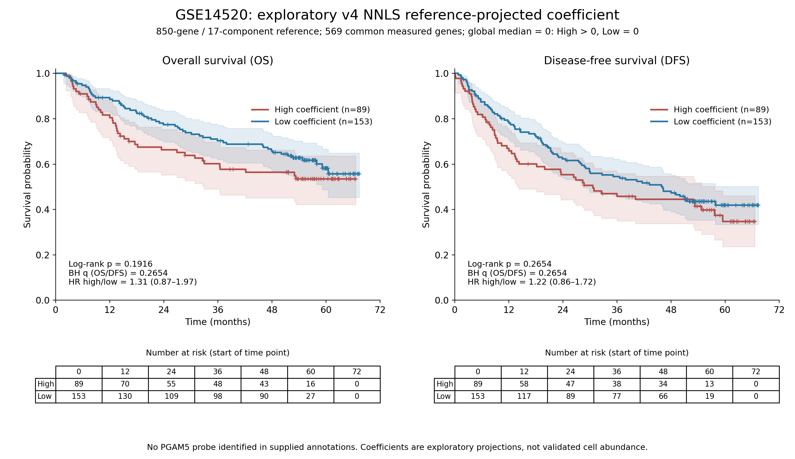
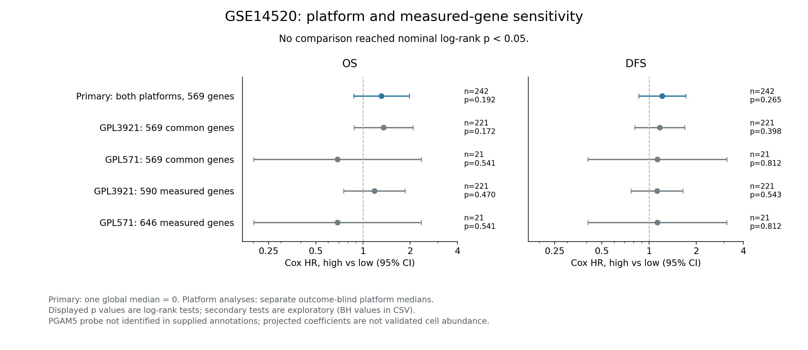

# GSE14520：第一版联合探索性参考的NNLS投影与生存

**按用户确认，使用此前850基因×17组分联合参考和固定NNLS。OS、DFS均未发现高低系数组间统计学显著差异。**

两个芯片平台的官方探针注释均没有PGAM5条目，亦未找到PGAM5 Entrez ID 192111或RefSeq NM_138575。这里表示当前注释没有可明确对应的PGAM5表达测量，不能解释为组织不表达PGAM5；没有执行探针序列重注释。本轮所得系数是原参考在其余可测基因上的投影，不是直接测量PGAM5或已验证的PGAM5⁺巨噬细胞丰度。

## 原始数据与范围

来源：[GSE14520](https://www.ncbi.nlm.nih.gov/geo/query/acc.cgi?acc=GSE14520)，官方两个RMA处理的series matrix、平台SOFT注释、Extra Supplement及README。488份表达样本中，按官方临床Tissue Type=Tumor筛选247个唯一患者、唯一GSM；不纳入配对非肿瘤或健康肝样本。

|平台|临床肿瘤患者|可测参考基因（850中）|PGAM5官方注释探针|
|---|---:|---:|---|
|GPL3921|225|590|未找到|
|GPL571|22|646|未找到|

主分析使用两平台共同可测的**569/850个基因（66.94%）**，相同基因行、相同17组分及原训练行缩放。未测基因从参考和查询同时剔除，不补零，不按生存结局改基因。coverage CSV列出所有850基因的覆盖情况。

## 芯片适配及固定求解

GEO处理说明：两种Affymetrix数据由matchprobes结合，使用RMA得到探针集表达摘要；本轮读取已发布的RMA值，没有重新运行CEL处理。探针按每个平台提供的Gene Symbol精确匹配，剔除控制、缺失及含///的多基因映射；同一基因的多个探针取log2 RMA中位数，再计算2^RMA得到线性强度。

各样本按全部无歧义映射基因线性强度总和缩放为和10000。它是计算尺度，不是RNA计数CPM/TPM或物理RNA比例；在不含额外约束的NNLS中，样本整体乘常数会使原始系数同比变化，除以全部系数之和后结果不变。独立有界求解器和标量缩放检查已验证该性质。

固定NNLS同时拟合全部17组分，原reference row_scale保持不变。目标为TAM_PGAM5_detected的sum-normalized coefficient，非巨噬细胞内占比。原参考和原TCGA分析均未修改；本次为芯片测量行投影，不是原850行完整模型在新平台上的直接验证。基因特异芯片响应、背景信号与单细胞平台偏差未校准。

247例中91例非零、156例为0；系数范围0–0.197382。全体247例中位数为0，预先固定**High > 0、Low = 0**，同一分组用于两终点，不使用TCGA数值切点或寻找最佳生存p值。零系数不证明组织没有该细胞群。

加权参考秩17，条件数10.51；相对拟合残差中位数0.791，提示与芯片表达的拟合有限。数学可求解不等于目标细胞具有可识别性。

## OS和DFS主分析

|终点|有效患者（事件）|High / Low|logrank p|OS/DFS两检验BH q|未调整Cox HR（95%CI）|
|---|---:|---:|---:|---:|---|
|OS|242（96事件）|89 / 153|0.191617|0.265417|1.31（0.87–1.97）|
|DFS|242（136事件）|89 / 153|0.265417|0.265417|1.22（0.86–1.72）|

每个终点5例因缺失或非正时间等预定条件排除，逐例原因见endpoint_excluded_patients.csv。有效242例中High 89、Low 153。结果均未达0.05，不能证明两组完全无差异或PGAM5没有生物学作用。OS两组均未达到50%死亡，KM中位OS未达到；DFS中位High 30.7个月、Low 46.1个月，是描述性估计而非显著差异证据。

曲线包含95%CI、删失标记及各时间点开始时风险人数；原始随访单位为月。官方README将Survival months定义为OS，将Recurr months定义为disease-free survival，故按原Recurr status/time分析DFS，未将其改称PFS或PFI，也没有另造死亡/复发复合终点。

主分析使用双侧普通logrank；Cox未调整HR及PH检验另存。OS High/Low PH p=0.07267，DFS p=0.14049。未拒绝PH假设并不证明恒定风险比必然成立。

## 连续系数、协变量及平台敏感性

调整年龄（每10岁）、性别、TNM I/II/III–IV及平台后的完整病例分析：

|终点|患者|调整后High/Low HR（95%CI）|Cox p|
|---|---:|---|---:|
|OS|225|1.08（0.69–1.68）|0.742612|
|DFS|225|1.01（0.69–1.47）|0.965164|

连续系数按全247例标准差固定转换，未调整及调整Cox亦未达到显著；完整协变量系数、PH检查和分析患者表全部保留。没有声称独立预后效应，未填补临床缺失。两平台病例来源不同，平台调整也不能消除所有队列混杂。

平台敏感性包括各平台内主569行投影，以及各平台全部可测参考行的投影；各方案用各自平台内的结局盲态中位数分组。GPL3921的有效随访221例，GPL571仅21例，后者精度有限；8项敏感性logrank检验均未显著，另提供8项BH校正。未按这些结果选择主方案。

## 解释边界

原参考此前未通过外部目标缺失等丰度验证。当前还存在低覆盖、无PGAM5直接探针、平台响应未校准及较大拟合残差。因此只能写作“GSE14520中，固定探索性参考投影系数的高低组与OS/DFS未发现显著关联”，不能写成“PGAM5⁺巨噬细胞真实丰度与预后无关”。生存显著与否均不能验证反卷积的细胞特异性。

## 复现与审计

下载结果ZIP后，安装requirements.txt并依次运行analyze.py、audit.py、build_report.py。包内包含两份官方压缩表达矩阵、完整临床表、用于匹配的全部探针注释字段、冻结参考与权重，不需重新下载单细胞或TCGA数据。原始平台SOFT含其他大量元数据，不重复打包；其原URL、原文件SHA256及抽取注释记录均保存。

独立审计通过91项，重算全部569×247=140,543个投影输入值、临床连接、零值保留、分组、KM步骤及风险人数；24例使用独立BVLS求解器复核全部17系数；两终点logrank按风险集独立重算，BH校正复核。审计验证实现，不代表参考通过生物学验证。

PNG用于查看，PDF用于导出，CSV用于复核。SHA256SUMS和输入provenance记录文件身份，ZIP经过CRC校验。此前TCGA及虚拟敲除结果保持不变。
