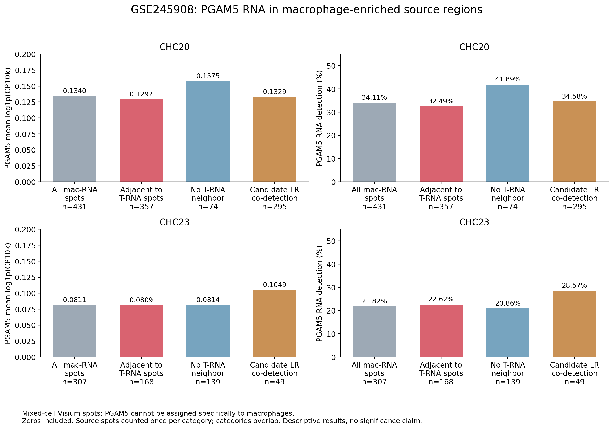

# 巨噬RNA富集区域邻近T细胞时的PGAM5表达

沿用此前GSE245908两张切片的固定质控、谱系RNA门控、PGAM5分层和第一圈邻接边，补充**源位点PGAM5表达量**。这与此前计算的邻近T程序分值、配体–受体兼容分值是不同指标。

**观察单位是混合细胞Visium位点。不能将下表视为单个巨噬细胞的PGAM5表达，也不能据此确认已发生巨噬细胞–T细胞互作。**

## 邻近区域的表达量

邻近T区域定义为巨噬/髓系RNA富集源位点在Visium第一圈内至少有一个T谱系RNA富集邻居。候选LR支持区域在此基础上要求21条固定候选至少有一条满足源配体和相邻目标全部受体亚基共检出。每个区域内按唯一源barcode计数，不重复计算同一源位点的多条边；不同区域互有重叠。

| 切片 | 区域 | 唯一源位点数 | PGAM5检出数/比例 | 含零值平均表达 | 含零值平均原始UMI |
|---|---|---:|---:|---:|---:|
| CHC20 | 邻近T RNA富集位点 | 357 | 116 / 32.49% | 0.1292 | 0.4370 |
| CHC20 | 无T RNA富集邻居 | 74 | 31 / 41.89% | 0.1575 | 0.5541 |
| CHC20 | 至少一条候选LR共检出 | 295 | 102 / 34.58% | 0.1329 | 0.4610 |
| CHC23 | 邻近T RNA富集位点 | 168 | 38 / 22.62% | 0.0809 | 0.2560 |
| CHC23 | 无T RNA富集邻居 | 139 | 29 / 20.86% | 0.0814 | 0.2302 |
| CHC23 | 至少一条候选LR共检出 | 49 | 14 / 28.57% | 0.1049 | 0.3265 |

平均表达单位为**mean(log1p(10,000 × PGAM5原始UMI / 全基因总UMI))**，包括PGAM5零值，先逐位点归一化再平均；不是log1p(平均CP10k)。这六个区域的PGAM5归一化表达中位数均为0。仅在检出位点中计算时，邻近T区域的平均表达分别为CHC20 0.3975、CHC23 0.3579。

上述未调整描述值不支持“互作区域PGAM5普遍升高”的结论：CHC20邻近区域均值低于无T邻居区域，CHC23两者接近。这不是显著性或等效性检验，本补充未检验这些区域的组间差异；空间混合、测序深度和组织位置可能影响描述值。此前50项条件检验针对High组与Other detected组的邻近T结局及LR结局，**不能将此前p/q用于本补充的区域PGAM5比较**。

## 已筛选PGAM5高表达源区域

在有T邻居的源点中，CHC20的PGAM5 High组有27点，PGAM5均值0.7360，中位数0.6978；CHC23有8点，均值0.6698，中位数0.6850。Other detected组分别89/30点，均值0.2948/0.2747。High是按PGAM5相对高表达选出的组，其高值是定义的结果，不能作为互作增强的独立证据。

## 活化/耗竭及具体候选区域

补充表也包含SPP1–CD44、PVR–TIGIT共检出源区域，以及邻近活化支持/耗竭支持T区域的源点。均纳入所有原PGAM5分组，**不是仅High组**。

| 切片 | 邻近T状态 | 唯一源位点数 | PGAM5检出数 | 含零值平均PGAM5表达 |
|---|---|---:|---:|---:|
| CHC20 | 活化支持 | 27 | 8 | 0.1591 |
| CHC20 | 耗竭支持 | 10 | 6 | 0.1208 |
| CHC23 | 活化支持 | 14 | 1 | 0.0286 |
| CHC23 | 耗竭支持 | 20 | 3 | 0.0590 |

这些状态分母较小，未作额外显著性检验。活化/耗竭标签是RNA程序代理，不能确证单个T细胞状态。全部11种源区域的原始计数范围、线性CP10k、含零值及仅检出均值见[汇总表](region_expression_summary.csv)。

## 图形、数据和复现

- [PNG](PGAM5_expression_T_neighbor_regions.png) / [PDF](PGAM5_expression_T_neighbor_regions.pdf)
- [全部区域表达汇总](region_expression_summary.csv)
- [逐源位点表达及区域成员](region_source_spot_expression.csv.gz)：不同区域互有重叠，同一个barcode可在不同region行中出现；sample＋region＋barcode应唯一。
- [输入SHA256](input_sha256.json) / [38项核验结果](validation.json)

在父目录完整结果已有时运行 `python summarize.py`。依赖沿用父目录requirements.txt。输入仅为父目录冻结的逐位点状态和逐边数据，代码读取表达数据而不执行其文本内容。验证唯一barcode、零值、原始计数/全基因库大小重建归一化表达、源/目标门控、逐源邻居数及互补区域总数。原有结果包未修改，本目录为单独的追加补充。
