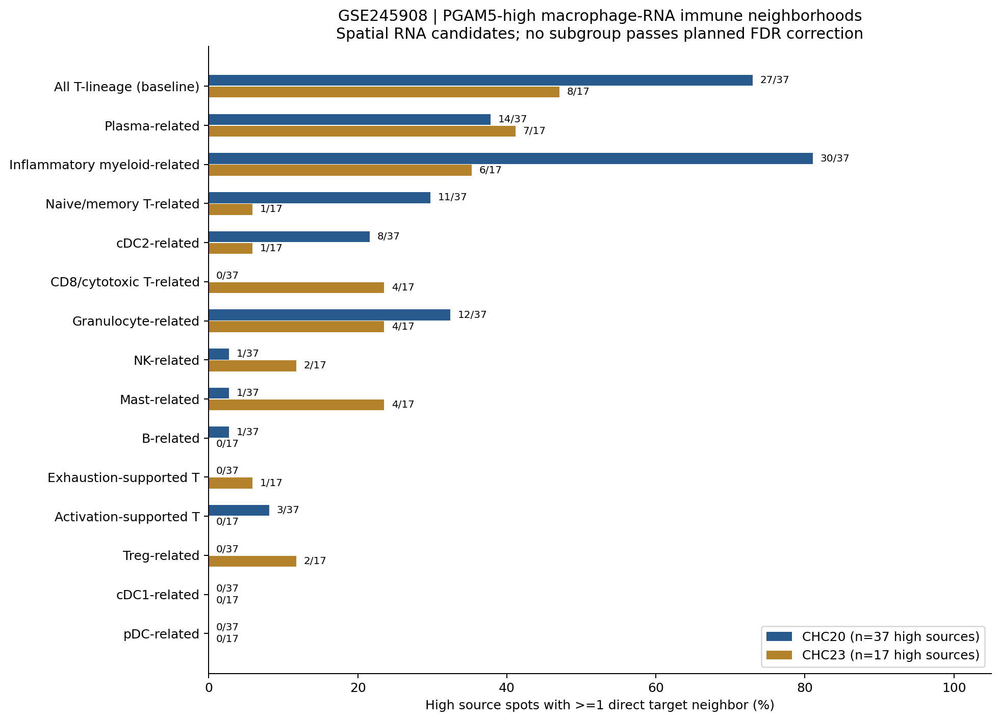
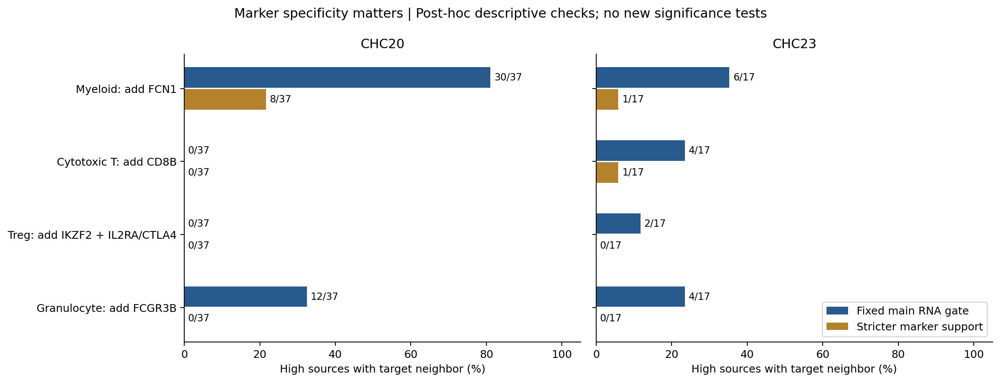

# GSE245908：PGAM5-high巨噬细胞相关免疫RNA邻域复核

本轮复用已有固定分析，重新核对原始数据、空间邻接、来源分母、标志严格性和统计，并增加两套更便于比较的概要图。没有根据结果重设来源分组、亚群门限或多重检验家族。

## 候选亚群

| RNA亚群候选 | CHC20有该类邻居的高表达源 | CHC23有该类邻居的高表达源 |
| --- | ---: | ---: |
| 浆细胞相关 | 14/37（37.8%） | 7/17（41.2%） |
| 炎症单核/髓系相关 | 30/37（81.1%） | 6/17（35.3%） |
| 初始/记忆T相关 | 11/37（29.7%） | 1/17（5.9%） |
| cDC2相关 | 8/37（21.6%） | 1/17（5.9%） |
| CD8/细胞毒T相关 | 0/37 | 4/17（23.5%） |

这些是每类去重的来源位点计数，目标可重叠，不能相加。没有把候选边数当作独立患者数，也不把以上比例解释成细胞丰度或通讯概率。

**没有亚群通过多重校正的差异检验**：主30项最小q=0.486，联合90项最小q=0.423。最常邻接的亚群不等于PGAM5-high选择性富集的互作对象。数据只有2例HCC Visium切片，不能确认单个巨噬细胞和单个免疫细胞的身份、配体来源或受体归属。



## 标志严格性改变支持数量



- 炎症单核/髓系标签要求额外检出FCN1后，有邻居的高表达源降为CHC20 8/37、CHC23 1/17，不能把宽松髓系标签全称为确定的单核细胞。
- CD8/细胞毒T额外要求CD8B后，CHC23支持从4/17降至1/17，CHC20仍为0/37。
- 严格Treg（IKZF2及IL2RA或CTLA4）和严格粒细胞（FCGR3B）在两样本均无高表达来源邻接。CHC23广泛检出FOXP3，不能单独据此确认Treg身份。
- 这些是事后描述性复核，没有取代固定主门限，也没有新增显著性检验；零支持不证明组织中没有对应细胞。

浆细胞相关RNA在两例中有相近的邻接比例，可优先作为后续验证候选。其他候选表现出明显病例差异或标志规则依赖，尚无已确认的特异互作亚群。

## 原始空间图与候选通路

- 真实H&E坐标图：[CHC20](../figures/CHC20_immune_subgroup_spatial_neighborhoods.png)、[CHC23](../figures/CHC23_immune_subgroup_spatial_neighborhoods.png)。金圈为PGAM5-high来源，蓝色为目标RNA门，紫线为直接六边格邻接。
- [全部15类RNA邻接、标志dotplot和空间条件检验](../README.md)。15类包含All-T基线及14个候选标签，并非15个互斥纯细胞群。
- [候选配体–受体共检出图](../figures/immune_subgroup_candidate_LR_codetection.png)。SPP1–CD44及CXCL12–CXCR4仅为部分邻域的RNA线索；未运行CellChat/LIANA通讯显著性求解，不能视为实际结合或PGAM5介导的功能作用。

## 来源、复核与复现

GEO：[GSE245908](https://www.ncbi.nlm.nih.gov/geo/query/acc.cgi?acc=GSE245908)，GSM7850822/CHC20及GSM7850823/CHC23。QC为in_tissue、UMI≥500、基因≥200、MT≤25%；全36,601个feature的库大小归一化为CP10k，未用marker子集重算分母。高表达定义为巨噬RNA门内PGAM5检出源的归一化Q75，保留并列。完整规则、原始HDF5及资源SHA、90项统计见[上级分析说明](../README.md)。本轮输入基于仓库提交 `d0c1dc80492eeabe849d57aefdc5331b421f9f61`。

本轮重新执行上级 `audit.py`，从原始HDF5计数核对所有程序、门限、来源标签、KD-tree六边格邻接、置换条件期望/p/BH、复合受体以及来源/目标分母；概要图另有38项直接邻接与严格规则核查，见[review_checks.json](review_checks.json)。SHA来源清单见[reference_manifest.json](reference_manifest.json)。没有重新下载GEO，也没有声称进行了新的全基因组细胞类型映射。

```bash
# 在上级分析目录安装其requirements.txt后
OPENBLAS_NUM_THREADS=1 python audit.py
python review_20261012/review.py
python build_report.py
python package_results.py
```

两套新图提供PNG/PDF，完整结果包包含原有7套图及本轮2套概要图。原统计、注释和数据不因新增概要图而更改。
