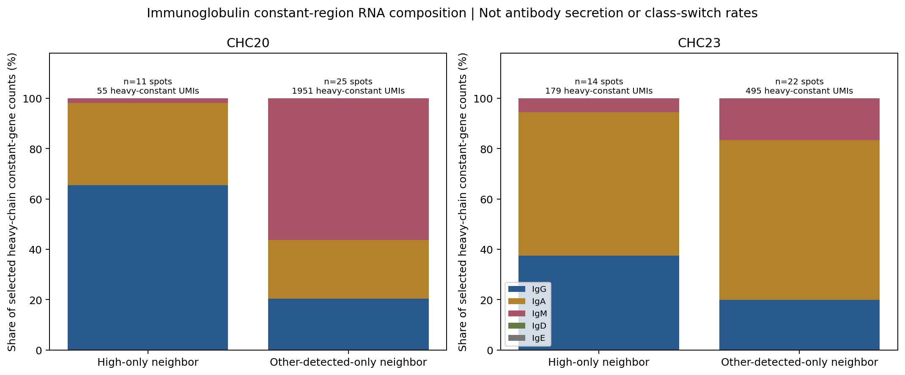
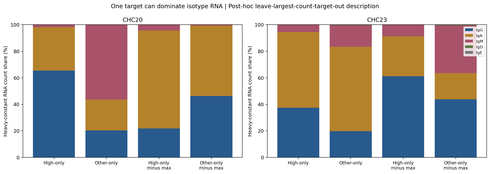
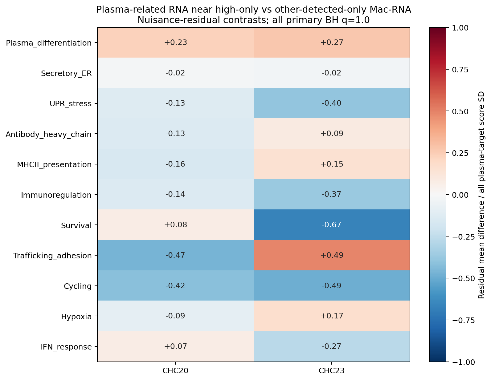

# GSE245908：PGAM5-high巨噬相关邻域中的浆细胞相关RNA功能特点

**现有数据不足以定义一种与PGAM5-high巨噬细胞特异互作的浆细胞功能状态。** 本轮分析的是Visium混合位点的浆细胞相关RNA信号；11套功能程序均未达到多重校正显著性（主22项和联合66项q均为1.0）。两例之间的抗体恒定区RNA构成不同，且部分结果受单个位点强烈影响，不能解释为PGAM5促进浆细胞分化、分泌或免疫抑制。

## 数据与主比较

本轮可用原始HDF5矩阵包含全部36,601个features，与之前GSE281759仅有marker输入的条件不同。按原始全库UMI计算CP10k、log1p，然后提取完整功能程序及混合RNA标志，不用子集总计数重新归一化。保留此前固定QC、巨噬源、PGAM5-high和浆细胞RNA门，没有按本轮结果重设阈值。

| 分组（浆细胞相关目标位点） | CHC20 | CHC23 |
| --- | ---: | ---: |
| 全部浆细胞相关位点 | 91 | 140 |
| 邻近至少一个PGAM5-high源 | 11 | 16 |
| 仅邻近high，未邻近其他PGAM5检出巨噬源 | 11 | 14 |
| 仅邻近其他检出源，未邻近high | 25 | 22 |
| 同时邻近两种源 | 0 | 2 |
| 两种检出源均未邻近 | 55 | 102 |

主比较为第三行vs第四行，避免把共同邻近两组的位点当作high独有对象。补充比较“任何high邻接vs无high邻接”，以及严格浆细胞标志后的互斥邻接组。邻接来自真实六边格第一圈、无自环，不是UMAP距离。

本轮目标计数11/16与前轮来源计数14/37、7/17不同：前者是去重浆细胞相关目标，后者是去重巨噬相关来源，一个目标可以连接多个源。它们都不是细胞数、浸润比例或通讯概率。前轮没有亚群通过特异邻接富集检验，不能把本轮邻接目标称为已经确认的互作浆细胞。

## 功能特点与证据强度

### 抗体类别RNA构成：病例差异与少量计数

仅邻近high的区域中，CHC20的所选重链恒定区RNA以IgG为主（65.5%），其次IgA（32.7%）；CHC23以IgA为主（57.0%），其次IgG（37.4%）。分母分别仅55和179个所选重链恒定基因原始计数，而不是抗体蛋白量、抗体分泌速率、细胞比例或类别转换率。

对照组CHC20 IgM比例56.3%，但其中1099个IgM计数有1093个来自一个位点`CAATGGATCTCTACCA-1`（99.45%）。CHC23对照IgM最大单点占48.15%。high组同样可能受少量位点支配，因此不能据此断言high邻域促进IgG/IgA或抑制IgM。





离群敏感性在每样本每组去掉所选重链总计数最高的一个目标后重新计算RNA构成，是事后描述性核查，没有添加显著性检验，也没有修改原始目标门或主统计。完整每目标计数及移除条码见`*_target_isotype_counts.csv.gz`、[isotype_count_concentration.csv](isotype_count_concentration.csv)、[isotype_leave_largest_out.csv](isotype_leave_largest_out.csv)。

**high-only组的“主要抗体类别”也会随单个位点改变**：CHC20去掉最高重链计数位点后IgG由65.5%降至21.7%、IgA升至73.9%；CHC23的IgA由57.0%降至30.1%、IgG升至61.2%。这进一步表明不能把原始构成标签当作稳健的IgG型/IgA型浆细胞群或PGAM5相关类别转换现象。

### 功能程序：均无显著差异



| 程序 | 固定基因 | 可以支持的解读 |
| --- | --- | --- |
| 浆细胞分化相关 | PRDM1、XBP1、IRF4、TNFRSF17 | RNA状态代理，未证实分化增强 |
| 分泌/内质网 | HSPA5、HSP90B1、SEC11C、SSR1/2、SEC61A1、FKBP11、P4HB | 分泌装置RNA，非实测抗体分泌能力 |
| UPR应激 | ERN1、ATF4、ATF6、DDIT3、DNAJB9、HERPUD1 | 应激相关信号，非UPR功能实验 |
| 抗体重链 | IGHG1–4、IGHA1/2、IGHM/D/E | 恒定区RNA丰度，不是蛋白/亲和力 |
| MHC-II抗原呈递 | HLA-DRA/DRB1/DPA1/DPB1、CD74 | 可来自混合抗原呈递细胞 |
| 免疫调节 | IL10、TGFB1、CD274、PDCD1LG2 | 未支持特异免疫抑制表型 |
| 生存相关 | MCL1、BCL2、BCL2L1、TNFRSF17 | RNA代理，不是存活或凋亡率 |
| 迁移/黏附 | CXCR4、ITGA4、ITGB1、CD44 | RNA相关，不能证明趋化方向 |
| 增殖 | MKI67、TOP2A、UBE2C、CENPF、BIRC5、PCNA | 未证实增殖差异 |
| 缺氧 | CA9、VEGFA、SLC2A1、LDHA、BNIP3、ADM | 可受肿瘤/其他混合细胞影响 |
| 干扰素应答 | STAT1、ISG15、IFIT1/2/3、MX1、IFI6、OAS1 | 未获得稳定的独特应答证据 |

若干调整后效应在两例同向（如增殖或调节程序偏低），但均不显著，部分原始差值与调整后方向不同。分化程序调整后差值为正不等于分化增强：未调整均值差在两例均为负。没有将图中的色块或方向当作显著功能发现，也没有把11个程序当作完整GO/KEGG/GSEA结果。

## 浆细胞身份与严格标志检查

原门使用MZB1/JCHAIN/SDC1/IGKC/DERL3的平均RNA≥样本Q75、>0且至少3个标志检出，同时要求MZB1或JCHAIN检出。该门不能排除混合上皮、B细胞、髓系和其他RNA成分；XBP1并非浆细胞专属，SDC1也不是专属标志。

追加MZB1、JCHAIN、DERL3三者均检出后，全部浆细胞相关目标由91/140降为6/3；其中**没有目标邻近high源**，仅1/2个属于其他检出源邻接组，严格比较不可检验。这个严格规则在稀疏空间RNA中可能过严、受掉落影响，不能据此证明没有浆细胞；它提示本轮宽松RNA标签的功能归属缺乏充分独立支持。

主high-only组的IL10在两个样本都未检出，IRF4也未检出；PRDM1检出率为0%/28.6%，MZB1为45.5%/14.3%。这些不是确定的阴性蛋白或细胞缺失，也不支持“IL10分泌型免疫抑制浆细胞”等强结论。标志表达及检出率见[marker_gene_descriptive_profiles.csv](marker_gene_descriptive_profiles.csv)。没有基因级显著性检验或正式DEG列表。

## 统计方法与空间稳健性

每套程序分数为其基因log1p(full-library CP10k)算术均值，包含零值。对全部固定浆细胞相关目标拟合不含邻接组标签的协变量模型：logUMI、MT%、浆细胞身份RNA、巨噬、T、B、肝细胞、上皮、内皮及成纤维RNA代理，加3×3粗空间区块。程序内基因从协变量基因列表中移除。效应是两组平均协变量残差之差，标准化值除以该样本全部浆细胞相关目标的程序SD；不是包含二元组别的完整回归系数、Cohen d或log2 fold change。调整RNA代理不能把位点变成纯浆细胞，亦可能去除部分真实生物学状态信号。

置换从**巨噬相关来源**而非目标位点标签开始：在检出PGAM5的源内按全片3×3坐标区块×源UMI二分位×巨噬核心二分位打乱high标签，每次保留源层内high数量，在同一真实邻接图上重新计算每个浆细胞相关目标的high/other邻居数量及分组，再求目标残差均值差。这保留了共享来源和固定图结构，避免把来源边当独立观察。

每项4,999次，种子245908105+GSM数字部分，双侧等尾p带+1校正、不假设条件零分布以0为中心。每次重分组至少5个high目标和10个对照目标才视为有效；不足则保留缺失，至少1000次有效置换才输出p，分母用有效次数+1。此条件化依赖可交换性和可分析组的条件，不能完全消除组织结构、自相关或混合细胞影响。主比较均有4999次有效置换。

主2样本×11程序=22项BH，联合2×11×3=66项BH；不可检验项p保留缺失，仅校正时以1计入。主22项与联合66项最小q均为1.0。仅2位患者，未合并位点制造患者总体p值、置信区间或因果结论。没有运行CellChat/LIANA通信显著性或虚拟敲除；本轮不证明PGAM5驱动浆细胞功能改变。

## 可视化与所有输出

- [功能RNA均值](figures/functional_program_profiles.png)
- [调整后功能对比](figures/adjusted_program_contrasts.png)
- [浆细胞标志表达/检出率](figures/plasma_marker_profiles.png)
- [分组及严格标志支持数量](figures/target_group_and_strict_support.png)
- [抗体类别构成](figures/immunoglobulin_isotype_composition.png)
- [最高计数位点敏感性](figures/isotype_count_concentration_sensitivity.png)
- 原始H&E坐标：[CHC20](figures/CHC20_plasma_spatial_profiles.png)、[CHC23](figures/CHC23_plasma_spatial_profiles.png)

共8套PNG/PDF。空间图使用真实坐标，源与目标直接邻接以线标出；两样本同一功能程序使用共同连续色标。颜色不能确认细胞身份或病理ROI，点数不能作为单细胞数。完整统计：[program_statistics.csv](program_statistics.csv)。

## 来源、验证与复现

GEO：[GSE245908](https://www.ncbi.nlm.nih.gov/geo/query/acc.cgi?acc=GSE245908)，GSM7850822/CHC20和GSM7850823/CHC23。源提交`03d37b43bf601eb4c98b74da7c263bd8bd5a0c52`。保留此前QC（in_tissue、UMI≥500、基因≥200、MT≤25%）及固定PGAM5-high Q75标签。引用[前轮亚群空间分析](../GSE245908_PGAM5_immune_subgroup_neighbors/README.md)的图、坐标及门限，原始HDF5来自同仓库GSE245908_spatial_PGAM5输入。

原始全矩阵SHA/字节及feature数见[raw_source_manifest.json](raw_source_manifest.json)，本轮完整功能marker输入SHA见[input_manifest.json](input_manifest.json)。结果包包含两个扩展marker AnnData、原始基因计数、全库归一化值、注释、图像、空间图及全部计算输出，可在已有依赖下离线重算；这些输入不是全36,601基因矩阵，不能用子集总计数再归一化，也不能直接开展全基因组富集。首次构建扩展输入需要同仓库的原始矩阵。

**724项核查通过**：[audit_results.json](audit_results.json)，包括原始HDF5 feature ID/计数/全库大小、扩展表达、独立KD-tree重建邻接、去重目标分组、严格标志、免疫球蛋白计数、独立完整OLS拟合对残差、来源标签数量、前3次来源重分组置换、有效p分母和BH。审核复用了协变量列表构造，不等于模型选择得到外部验证。人工查看核心效应图、空间图及抗体离群敏感性图。

```bash
python -m venv .venv
. .venv/bin/activate
pip install -r requirements.txt
OPENBLAS_NUM_THREADS=1 python analyze.py
OPENBLAS_NUM_THREADS=1 python plot.py
OPENBLAS_NUM_THREADS=1 python audit.py
OPENBLAS_NUM_THREADS=1 python isotype_sensitivity.py
python package_results.py
```

如果原始HDF5不在工作目录，审核仅运行扩展输入及图/统计核查，跳过原始全矩阵比对，检查数会降低；不会声称重新核验原始矩阵。完整结果包：[GSE245908_PGAM5_macrophage_plasma_function_all_results.zip](GSE245908_PGAM5_macrophage_plasma_function_all_results.zip)。
