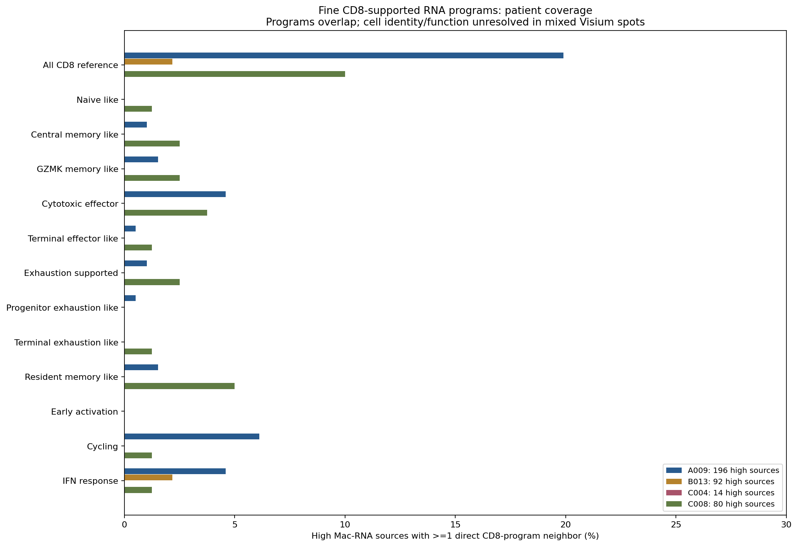

# GSE281759：PGAM5-high 巨噬 RNA 邻域中的 CD8 细分程序

**在固定的193个CD8支持RNA位点内检查12类预设程序，并记录最细的多程序组合。49个独立CD8目标与PGAM5-high源实际直接相邻，共57条边；较常见的是增殖支持、IFN响应、细胞毒效应程序。未发现任何程序具有统计显著的PGAM5-high特异邻接。**

“最细”是本轮可复核的多基因程序与其组合，**不是证明12种或20种单细胞亚群**。Visium混合细胞位点不能确定CD8A/B、功能标志及受体来自同一细胞，也不能确定源PGAM5来自巨噬细胞。增殖/IFN信号可能混入肿瘤或其他细胞。邻接、RNA共检出均非功能互作、因果机制或细胞通讯概率。

## 范围与固定源门

4位HCC患者、16张肿瘤切片（15原发、1复发），25,354个QC位点。排除A009N；B0013/B013统一为B013；C004T1P/R是同一患者。没有病理ROI分割，不能认定肿瘤切片的每个位点都是恶性区域。

使用用户上传的完整36,601-feature计数矩阵，48个matrix/features/barcodes文件逐一按既有NCBI清单SHA256及大小核验。A009T4/T5由两分卷拼接。条形码顺序、全库UMI和全部179个既有marker计数均与基线完全一致。目标和LR基因在各片features表中唯一映射，不合并同名不同ID。

沿用原主QC：in_tissue=1、UMI≥500、检出基因≥200、MT≤25%。原论文MT≤5%，本轮未复算完整MT5敏感性分析。巨噬门为核心程序（C1QA/B/C、CD68、CSF1R、MERTK、MSR1）≥全片Q75且≥3检出标志、Pan-myeloid≥全片中位数。PGAM5-high为巨噬门内PGAM5检出源的归一化表达≥检出源Q75，保留并列，阈值不在CD8邻域内重设。382个high源、1,122个有邻居的其他检出源。

## CD8细分规则

CD8父门完全复用前轮：既有T谱系门（CD3D/E/G、TRAC、TRBC1/2，分数≥切片Q75、≥2谱系标志），同时CD8A和CD8B原始计数>0、CD8A/B平均log1p(CP10k)≥T门内Q75且>0。独立重建父门一致，共193个位点；没有重新选“更高CD8”的邻近子集。

以下12程序均限定在固定CD8父门内。均值含零值、使用完整全库UMI分母；分数≥本片CD8父门Q75且>0，另要求最少标志检出和锚点。先固定程序和检验家族，再计算邻接，未以显著性或图形结果调阈值。

| 程序 | 基因 | 最少检出 | 锚点 |
|---|---|---:|---|
| 初始样 | CCR7、SELL、TCF7、LEF1、MAL | 3 | CCR7或SELL，且TCF7或LEF1 |
| 中央记忆样 | CCR7、IL7R、LTB、TCF7 | 3 | CCR7和IL7R |
| GZMK记忆样 | GZMK、IL7R、CCL5 | 2 | GZMK，且IL7R或CCL5 |
| 细胞毒效应 | NKG7、PRF1、GZMB、GNLY、CTSW、CCL5 | 3 | PRF1或GZMB |
| 终末效应样 | FGFBP2、CX3CR1、GZMH、PRF1、NKG7、KLRG1 | 3 | FGFBP2或CX3CR1 |
| 耗竭支持 | PDCD1、LAG3、TIGIT、HAVCR2、TOX、ENTPD1、CXCL13、CTLA4 | 3 | PDCD1或TOX |
| 祖细胞耗竭样 | TCF7、SLAMF6、PDCD1、TOX | 3 | TCF7和PDCD1 |
| 终末耗竭样 | HAVCR2、ENTPD1、CXCL13、TOX、LAG3、PDCD1 | 3 | HAVCR2或ENTPD1，且TOX或PDCD1 |
| 组织驻留记忆样 | CD69、ITGAE、CXCR6、ZNF683、ITGA1、RGS1 | 3 | ITGAE或ZNF683或ITGA1 |
| 早期活化 | CD69、IL2RA、TNFRSF9、ICOS、CD40LG、IL2 | 2 | CD69或IL2RA或TNFRSF9或ICOS |
| 增殖支持 | MKI67、TOP2A、STMN1、TYMS、PCNA | 3 | MKI67或TOP2A |
| IFN响应 | STAT1、ISG15、IFIT1、IFIT3、MX1、OAS1、IFI6 | 3 | IFIT1或IFIT3或MX1 |

记忆/耗竭/驻留/活化/增殖是可重叠的状态轴，不互相排除。祖细胞耗竭样不强制满足通用耗竭门；TCF7+PDCD1支持仅为候选，未证明自我更新。终末耗竭样也不能证明不可逆功能损失。未使用PTPRC总表达推断CD45RA/RO，故未标TEMRA；缺乏VDJ及单细胞归属，不确定MAIT、NKT或TCR克隆。无单细胞参考反卷积、蛋白/功能或病理验证。

## 邻近CD8细分结果

下表第二列分母193为全队列CD8父门；第三列分母49为与high源邻接的**独立CD8目标**；第四列分母382为high源。独立目标与源数量是不同指标，恰好本轮都为49不代表一对一对应。类别和覆盖数可以重叠，不能相加。

| 程序 | 全部CD8目标 | 邻近high的独立目标 | 有该类邻居的high源 |
|---|---:|---:|---:|
| CD8父门基线 | 193 | 49 | 49/382 |
| 增殖支持 | 47 | 12 | 13/382 |
| IFN响应 | 50 | 11 | 12/382 |
| 细胞毒效应 | 29 | 10 | 12/382 |
| GZMK记忆样 | 24 | 6 | 5/382 |
| 驻留记忆样 | 26 | 6 | 7/382 |
| 耗竭支持 | 17 | 4 | 4/382 |
| 中央记忆样 | 8 | 3 | 4/382 |
| 终末效应样 | 6 | 2 | 2/382 |
| 初始样 | 3 | 1 | 1/382 |
| 祖细胞耗竭样 | 2 | 1 | 1/382 |
| 终末耗竭样 | 9 | 1 | 1/382 |
| 早期活化 | 8 | 0 | 0/382 |

早期活化无符合门控的邻近目标，并不证明不存在活化CD8细胞。初始/祖细胞耗竭/终末效应等极稀疏，无法建立稳定群体结论。不满足程序门控并非没有相应细胞或生物学功能。

### 最细程序组合

每个CD8目标按12个二元程序保存完整组合，即`exact_program_signatures.csv`与逐位点`CD8_program_signature`。全队列观察到48种组合标签；high邻近的49个独立目标有20种观察标签，其中17个位点为`No_supported_program`（没有满足任何程序门，不叫初始/静息群）。其余32个位点有至少一个程序，组成19种非空组合。多个组合只有1个位点，**不称为新亚群、不进行事后组合显著性检验**。

较常见的互斥组合为：未满足细分门17个、仅增殖7个、仅IFN5个；仅细胞毒、仅驻留及增殖+IFN各2个。组合可以包括细胞毒+耗竭+驻留等，但共现可能来自混合RNA而非同一CD8细胞。ID、完整组合和计数见`high_near_exact_signature_summary.csv`。

## 患者比较与空间统计

| 患者 | 全部CD8父门 | high邻近独立CD8目标 | high源有CD8邻居 |
|---|---:|---:|---:|
| A009 | 145 | 38 | 39/196（19.9%） |
| B013 | 25 | 2 | 2/92（2.2%） |
| C004 | 1 | 0 | 0/14（0.0%） |
| C008 | 22 | 9 | 8/80（10.0%） |

患者是独立生物学单位，切片、共享目标、边数不能增加病例数。C004数据不足以比较细分CD8群。患者覆盖率及同患者可检验切片的等权效应中位数是描述性汇总，没有将合并位点用作独立病例的普通t/Wilcoxon总体检验。

使用QC后真实Visium六边格第一圈六方向，无自环。统计量为high源有≥1该程序邻居的比例减对照比例，单位百分点。每片、每程序4,999次条件标签置换；层为全片3×3粗空间区块×当前源UMI二分位×巨噬核心二分位，保留层内high数。双侧等尾p含+1校正，不假定零分布中心为0。high<5、对照<10或零分布恒定标不可检验。

预设新增12×16=192项主家族（high vs other detected），另两比较（high vs all other mac、排除T富集源的high vs other detected）共576项联合家族；排除复发另保留180项主BH。CD8父门基线与组合只描述，不新增检验。不可检验p保留缺失、仅校正时计1。

主192项43项可检验、149项不可检验；另外两比较50和26项可检验。**主、联合和原发限定家族最小q均为1.0；主最小p=0.0576（C008T1驻留样），未有p<0.05主结果。**新增探索家族不意味着对全部历史分析的联合FDR保证。粗分层不能完全消除空间自相关、共享邻居和混合细胞比例；未显著不证明不存在生物学作用。

独立目标另分为三种互斥邻域：high邻近49个（可同时邻近其他检出源）、仅其他检出源邻近75个、两类源均不邻近69个。最后一类仍可能邻近未检出巨噬源。“high邻近”不是只邻近high。`CD8_target_neighborhood_programs.csv`保留逐片程序频率/分数，仅描述，不对这些事后目标分区做伪独立检验。

## 候选配体–受体

采用之前LIANA1.10.0资源快照定义，共21对候选。只统计high源→实际相邻CD8目标：源配体原始计数>0，目标所有受体亚基>0；不把PGAM5当配体。57条CD8父门候选边中，CCL5–CCR5为11/57、SPP1–CD44与NECTIN2–TIGIT及CXCL10–CXCR3各8/57、LGALS9–HAVCR2为7/57、PVR–TIGIT为6/57。这些不是通路强度排名或结合证据。

源/目标可共享，不同细分程序分母不同；受体可能来自混合位点的其他细胞。受体又可能参与耗竭程序门，不能作为独立身份或耗竭验证。未运行CellChat/LIANA通讯显著性算法，没有证明功能方向、PGAM5介导机制或治疗效应。完整分母、独立源/目标计数见`candidate_LR_codetection.csv`。

## 可视化



- [最细组合与计数](figures/CD8_high_near_exact_signatures.png)。
- [实际邻近目标标志证据](figures/CD8_fine_marker_evidence.png)：仅使用49个high邻近目标；定义基因不是独立验证，n=0留空。
- [逐切片差异](figures/section_CD8_fine_differences.png)、[目标邻域程序比例](figures/CD8_unique_target_zones.png)。
- [程序重叠](figures/CD8_program_overlap.png)、[候选LR共检出](figures/CD8_fine_LR_codetection.png)。
- 每患者两组H&E真实空间图：[A009-1](figures/A009_CD8_fine_spatial_part1.png)、[A009-2](figures/A009_CD8_fine_spatial_part2.png)、[B013-1](figures/B013_CD8_fine_spatial_part1.png)、[B013-2](figures/B013_CD8_fine_spatial_part2.png)、[C004-1](figures/C004_CD8_fine_spatial_part1.png)、[C004-2](figures/C004_CD8_fine_spatial_part2.png)、[C008-1](figures/C008_CD8_fine_spatial_part1.png)、[C008-2](figures/C008_CD8_fine_spatial_part2.png)。

共15组PNG/PDF。图中红圈为high巨噬RNA源、蓝点为CD8细分目标、线为实际邻接。使用原组织像素坐标及缩放，不使用UMAP距离。LR无边的单元显示NA而非0。

## 来源、核验和复现

GEO：[GSE281759](https://www.ncbi.nlm.nih.gov/geo/query/acc.cgi?acc=GSE281759)。源仓库提交`d692278803b667a7c2891a173e31b71cd2513214`。48个原始附件来源、SHA及本地路径见`input_manifest.json`；基线空间对象/图像在`GSE281759_spatial_HCC_PGAM5`，父门对象在`GSE281759_PGAM5_Tcell_extended`，空间置换函数在`GSE281759_PGAM5_immune_subgroup_neighbors/analyze.py`。

752项来源、全库UMI、旧marker、CD8父门、逐源显式邻居和组合分区检查通过。另有5,588项独立检查通过，涵盖全库归一化、父门、新门控、格邻接、源PGAM5门、目标分区/实际CD8边、逐LR检出、置换p和BH（`independent_audit_results.json`）。程序核验不能替代细胞归属验证。

每片`*_CD8_fine_markers.h5ad`保留本轮标志及LR原始计数、全库归一化、注释和空间图，**不是完整全基因对象**。全基因矩阵不重复推送GitHub；已有基线对象从同仓库读取。逐位点注释、直接边、精细组合、置换零分布、患者汇总、图和代码均入包。

```bash
git clone https://github.com/183285068-droid/codex.git
cd codex
python -m venv /tmp/gse281759_cd8_env
. /tmp/gse281759_cd8_env/bin/activate
pip install -r results/GSE281759_PGAM5_CD8_fine_programs/requirements.txt
export GSE281759_INPUT_DIR="/你的48个原始附件目录"
OPENBLAS_NUM_THREADS=1 python results/GSE281759_PGAM5_CD8_fine_programs/analyze.py
OPENBLAS_NUM_THREADS=1 python results/GSE281759_PGAM5_CD8_fine_programs/plot.py
OPENBLAS_NUM_THREADS=1 python results/GSE281759_PGAM5_CD8_fine_programs/audit.py
python results/GSE281759_PGAM5_CD8_fine_programs/package_results.py
```

细分证据已覆盖本轮预设程序及全部观察组合，但基于193个混合RNA位点的稀疏性，不能宣称完成单细胞层面的最细分类。进一步确定细胞身份及谱系需要匹配单细胞参考、空间反卷积/细胞分辨率数据；确定互作功能需独立实验。
