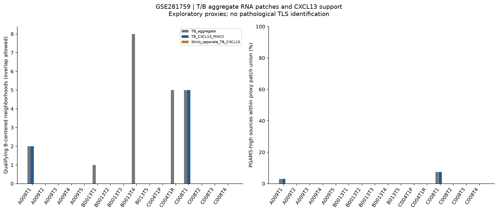

# GSE281759：PGAM5-high巨噬细胞相关位点与TLS相关RNA候选区域

**结论：本轮没有获得PGAM5-high巨噬细胞相关位点与TLS发生特异相互作用的充分证据。** 在现有标志子集可评估的T/B聚集RNA代理区域中，没有观察到PGAM5-high相对其他巨噬RNA位点的多重校正显著关联。由于TLS关键标志、独立病理/IHC标注和单细胞归属均不足，既不能确认这些区域就是TLS，也不能证明TLS或互作不存在。

## 可用证据与TLS确认限制

输入为16张肿瘤Visium切片、4位患者、25,354个QC位点、4,091个巨噬RNA相关位点及382个PGAM5-high位点。源门和高表达定义保持此前固定规则。标志AnnData只有179个选择基因，来自全部36,601个feature的库大小归一化值保留，没有用子集总计数重新归一化。

TLS不仅是T/B表达共现，确认通常需要组织聚集、T/B区域组织化、滤泡树突状细胞、高内皮微静脉等证据，成熟TLS还涉及生发中心特征。不同成熟阶段不一定全部具备上述标志；本轮缺乏足够信息判断其阶段。本分析的基因列表是说明覆盖缺口的示例，不是经过验证的TLS分类器。

| 证据维度 | 文件中存在的基因 | 缺失的示例基因 |
| --- | --- | --- |
| TLS相关趋化/淋巴组织信号 | CXCL13 | CCL19、CCL21、LTB、LTA |
| B谱系 | MS4A1、CD79A/B、CD19、CD22 | 本轮列表覆盖完整 |
| T谱系 | CD3D/E/G、TRAC、TRBC1/2 | 本轮列表覆盖完整 |
| Tfh相关 | ICOS、PDCD1、CD40LG | CXCR5、BCL6 |
| FDC相关 | CXCL13（非FDC特异） | CR2、FCER2、FDCSP |
| HEV相关 | 无本轮示例标志 | CHST4、ACKR1、SELE、CCL21 |

CXCL13可来自多种细胞，MHC-II也非TLS特异；现有Tfh程序不足以确认Tfh。未将浆细胞浸润或普通T/B共现直接标作TLS。原论文保存的全文仅在背景介绍中讨论TLS，未向本轮提供独立TLS病理区域。H&E图可供复核，但没有开展经病理专家验证的TLS判读、CD3/CD20/CD21/PNAd等IHC或空间细胞分割。

本轮尝试读取NCBI FTP原始矩阵，当前环境代理返回403，不能补齐全基因标志。没有借助其他数据集替代GSE281759，也未伪造缺失表达。详细覆盖及检出率：[TLS_marker_coverage.csv](TLS_marker_coverage.csv)。

## 固定的探索性候选规则

全部规则在计算候选数量及显著性前写入 [analysis_config.json](analysis_config.json)。它们是人为透明的空间RNA代理，不是原论文TLS注释或已经验证的TLS诊断标准。

1. **T/B聚集（TB_aggregate）**：以B-RNA门内位点为中心，在Visium六边格两圈内（含中心，完整格最多19个位点），至少2个B门位点、3个T门位点、5个不同的T或B门位点；至少1个只满足B门、1个只满足T门，而且二者在该局部邻域内有真实直接邻接。
2. **CXCL13/MHC-II支持（TB_CXCL13_MHCII）**：在上述规则上追加≥1个CXCL13原始计数检出位点及≥1个检出至少3/5个MHC-II标志的位点。
3. **更严格的分开T/B及CXCL13规则**：追加≥2个B-only、≥3个T-only、≥2个CXCL13检出位点并保留MHC-II支持。

T门为原固定CD3D/E/G、TRAC、TRBC1/2程序≥切片Q75且至少2个标志检出。B门为MS4A1/CD79A/B/CD19/CD22均值≥全片Q75、分数>0、至少2个检出，并检出MS4A1或CD19。B-only/T-only只是不同时满足另一RNA门，不能当成真实单细胞类型。MHC-II为HLA-DRA/DRB1/DPA1/DPB1/CD74。

候选范围是符合条件中心的两圈邻域的并集，可能包括低淋巴信号位点；**不是病理TLS边界、病灶大小或细胞数**。重叠中心可合并为连通分量，连通分量也不能称为TLS个数。两圈距离是探索参数，不是普适TLS尺度。

## 结果

| 候选层级 | 有候选的切片 | 符合条件中心 | 并集内PGAM5-high源 | 并集外直接邻接的PGAM5-high源 |
| --- | --- | ---: | ---: | ---: |
| 普通T/B聚集RNA | A009T1、B0013T1、B0013T4、C004T1R、C008T1 | 21（可重叠） | 3 | 2 |
| CXCL13/MHC-II支持RNA | A009T1、C008T1 | 7（可重叠） | 3 | 0 |
| 更严格规则 | 无符合区域 | 0 | 0 | 0 |

更严格规则无符合区域不证明没有真实TLS，可能反映输入覆盖、表达掉落、切片采样及所选阈值。普通T/B聚集也可能是非TLS的炎性浸润。

| CXCL13/MHC-II候选切片 | 候选中心 / 并集位点 | high源位于并集 | 其他PGAM5检出源位于并集 | high源并集外有直接邻接 | 主BH q |
| --- | --- | --- | --- | --- | --- |
| A009T1 | 2 / 24 | 1/34（2.94%） | 3/99（3.03%） | 0/33 | 1.0 |
| C008T1 | 5 / 38 | 2/27（7.41%） | 11/80（13.75%） | 0/25 | 1.0 |

并集内比率分母为该片全部有空间邻居的对应源组；外部邻接比率分母仅为并集外的源，因此与并集内分母不同。其他切片无CXCL13/MHC-II支持候选，不能当成“确认无TLS”的对照病例。

**3个范围内high源均有混合淋巴RNA信号**：A009T1的`TCTCCAACGTAGGTTA-1`同时满足B门（PGAM5原始计数1）；C008T1的`CCTGTCACCCGGGCTC-1`和`GGCAGCGGTAATCCTA-1`同时满足T门（PGAM5计数2及1）。排除T/B门阳性源后，较支持候选范围内high来源为0。PGAM5-high是检出源归一化Q75定义，原始计数低并不矛盾；但不能把这里的PGAM5归属到巨噬细胞或推断蛋白高表达。上述位点详见逐片注释表。

主32项只有4项可检验，其他28项因无候选/恒定零分布等不可检验；全部288项中20项可检验、268项不可检验。**主32项及联合288项最小q均为1.0，无显著富集或减少。** 绝大多数比较不可检验，样本和空间支持很稀疏，不能把“未显著”当作“没有互作”。仅3个高表达源位于较支持的候选范围内，也不足以推断选择性趋化、促进TLS形成或抑制TLS。

完整位点/中心注释和患者、切片编号见逐片`*_TLS_proxy_annotations.csv.gz`；统计及分母见 [spatial_statistics.csv](spatial_statistics.csv)、[section_candidate_summary.csv](section_candidate_summary.csv)、[source_candidate_counts.csv](source_candidate_counts.csv)。

## 可视化



- [主要空间比例差](figures/primary_spatial_contrasts.png)
- [TLS相关标志覆盖](figures/TLS_marker_coverage.png)
- 真实H&E与Visium坐标叠加：[A009](figures/A009_TLS_proxy_spatial_maps.png)、[B013](figures/B013_TLS_proxy_spatial_maps.png)、[C004](figures/C004_TLS_proxy_spatial_maps.png)、[C008](figures/C008_TLS_proxy_spatial_maps.png)

共7套PNG/PDF。青色透明区域为代理邻域并集，青框为符合条件B中心，蓝点为T-RNA、金点为B-RNA，粉色空心圈为PGAM5-high巨噬RNA源。TLS不由这些绘图颜色或边界确诊。位置来自原图像缩放及真实像素坐标，不是UMAP、虚构坐标或病理ROI。NA代表无法检验，不是0效应。

## 空间比较与解释

主比较为CXCL13/MHC-II支持层级中high vs其他PGAM5检出巨噬源，分别检验①位于候选并集，②并集外直接邻接。补充另外两层候选、high vs所有其他巨噬源，以及排除满足T门或B门的源后high vs其余检出源。源门及逐片PGAM5检出源Q75保留原定义，未按本轮结果重设；所有统计源至少有一个QC后空间邻居。普通邻近位点中的PGAM5不一定来自巨噬细胞，排除T/B源亦不能清除混合细胞。

每比较4,999次high标签置换，仅在全片3×3粗空间区块×当前源UMI二分位×巨噬核心二分位内交换，保留层内标签数量。双侧等尾p有+1校正，不假设零分布以0为中心。high≥5、对照≥10且非恒定条件零分布才输出p；不可检验p保留缺失，仅BH时按1计入预设家族。主2结局×16片=32项，联合3层级×2结局×3比较×16片=288项。

这些是条件空间关联检验，不是TLS通信显著性、因果检验或细胞功能实验。粗分层不能完全消除组织结构、自相关和共享邻域。4位患者才是独立生物学单位，多个重叠中心、切片或位点不能增加病例样本量；没有合并位点产生跨患者p值。未运行CellChat/LIANA、未推断TLS内具体配体–受体相互作用；关键CXCL13受体CXCR5缺失也阻止完整该轴评估。

## 来源、审核及离线复现

GEO：[GSE281759](https://www.ncbi.nlm.nih.gov/geo/query/acc.cgi?acc=GSE281759)，论文PMID 41950768。使用同仓库[前轮空间数据](../GSE281759_spatial_HCC_PGAM5/README.md)的16个AnnData，基于源提交 `6846265f07567f7b24ce8eea9b345f664d069c51`。主QC为in_tissue、UMI≥500、基因≥200、MT≤25%，不同于原论文MT≤5%；本轮未重做MT5全TLS代理分析。排除A009N非肿瘤切片；B0013T1–T4与B013T5同患者B013，C004T1P/R为同患者原发/复发。

完整结果包内包含本轮全部图表、统计、审核数组、代码、说明及16个原始marker输入对象，可离线复现，**不包含无法取得的全基因原始矩阵**。SHA清单见 [input_manifest.json](input_manifest.json)，前轮原始官方文件URL/SHA见 [source_manifest](../GSE281759_spatial_HCC_PGAM5/source_manifest.json)。

**8,635项核查通过**：[audit_results.json](audit_results.json)。包括SHA、全库归一化、独立B门、PGAM5原始计数和固定Q75标签、KD-tree重建直接邻居后集合遍历两圈及T/B接触、各层中心/并集/外侧邻接、全部分母、前3次置换统计、层内标签数量、p与BH，以及3个范围内high源的混合RNA复核（[mixed_source_review.json](mixed_source_review.json)）。人工检查主要概览与真实组织图，并验证不依赖前轮目录的独立导入和16个输入对象均已包含。没有声称完成TLS病理判读或对缺失的全基因矩阵进行核验。

```bash
python -m venv .venv
. .venv/bin/activate
pip install -r requirements.txt
OPENBLAS_NUM_THREADS=1 python analyze.py
OPENBLAS_NUM_THREADS=1 python plot.py
OPENBLAS_NUM_THREADS=1 python audit.py
python package_results.py
```

压缩包：[GSE281759_PGAM5_TLS_all_results.zip](GSE281759_PGAM5_TLS_all_results.zip)。后续确认需获取全基因矩阵、在组织上标注TLS并用合适病理/IHC支持，随后按真实TLS边界重复与PGAM5高表达巨噬细胞的空间比较。
