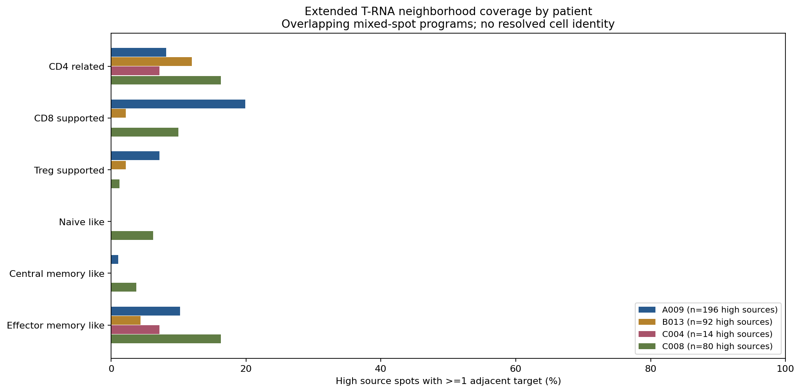

# GSE281759：全基因矩阵补充 T 细胞亚群相关空间 RNA 分析

**已从用户上传的全基因计数矩阵补充 CD4、CD8、Treg、初始样及记忆样 T 程序。CD8 支持、CD4 相关及效应记忆样是本轮较常见的邻近候选；没有新增类别显示 PGAM5-high 特异邻接的统计证据。**标签代表混合 Visium 位点中的多基因 RNA 程序，不是已确认的单细胞亚群或功能互作。

## 原始数据恢复与范围

16 张肿瘤切片的 matrix、features、barcodes 共48个文件均按前轮 NCBI 来源清单的文件大小及 SHA256 校验；A009T4/T5 矩阵由上传 part00+part01 拼接。每片完整矩阵36,601个features，按原始条形码对齐既有QC位点；全库 UMI 和全部179个既有 marker 原始计数均完全一致。重复基因符号按 AnnData 原规则加后缀，旧对象优先按 gene ID 对齐，未合并不同 ID。

4位患者：A009、B013、C004、C008；16张肿瘤切片，25,354个QC位点。C004T1P/R为同一患者的原发/复发；B0013/B013统一为B013。排除A009N；未进行病理恶性ROI分割。382个PGAM5-high巨噬RNA源，主对照1,122个有空间邻居的其他PGAM5检出源。

源门、PGAM5阈值、QC及空间邻接保持前轮定义，未根据新增目标改变PGAM5高组。QC为in_tissue=1、UMI≥500、检出基因≥200、MT≤25%；原论文MT≤5%，本轮未完成MT5全分析敏感性。来自巨噬RNA富集位点的PGAM5不能确定来自巨噬细胞，而非肿瘤或其他混合细胞。

## 新增目标定义

所有新目标都必须满足此前固定T谱系门（CD3D/E/G、TRAC、TRBC1/2，分数≥全片Q75、≥2标志）。新增程序分数为所列基因的平均log1p(CP10k)，包括零值；CP10k分母为完整矩阵全库UMI。统一要求分数≥该切片T门内Q75且>0。阈值在检验前固定，不按邻接结果调参。

| RNA程序 | 基因 | 至少检出 | 额外锚点 |
|---|---|---:|---|
| CD4相关 | CD4、IL7R、LTB | 2 | CD4 |
| CD8支持 | CD8A、CD8B | 2 | CD8A和CD8B |
| Treg支持 | FOXP3、IL2RA、CTLA4、IKZF2、TIGIT | 2 | FOXP3 |
| 初始样 | CCR7、SELL、TCF7、LEF1、MAL | 3 | CCR7或SELL，且TCF7或LEF1 |
| 中央记忆样 | CCR7、IL7R、LTB、TCF7 | 3 | CCR7和IL7R |
| 效应记忆样 | GZMK、CCL5、IL7R | 2 | GZMK且CCL5或IL7R |

这些为探索性多基因门控，**没有单细胞参考反卷积或蛋白验证**。CD4可来自髓系、CD8A可来自NK；Treg辅助标志也与活化/耗竭共享，FOXP3共检出并不证明抑制功能。初始与中央记忆基因重叠，故保留重叠而非强制互斥。效应记忆样是GZMK相关候选，未要求低CCR7/SELL，不能当成已确认的效应记忆细胞。共享位点可能是混合细胞RNA，而非双阳性单细胞。

所有所需标志在每片features表中有对应列，实际检出数见 `marker_detection.csv`；“有基因列”不代表表达充分，更不保证每个亚群都可可靠判定。逐片阈值和目标数见 `thresholds.csv`。

## 主要结果

| 新增T程序 | 目标位点总数 | 有该类直接邻居的高表达源 | 覆盖率 |
|---|---:|---:|---:|
| CD8支持 | 193 | 49/382 | 12.8% |
| CD4相关 | 346 | 41/382 | 10.7% |
| 效应记忆样 | 296 | 38/382 | 9.9% |
| Treg支持 | 126 | 17/382 | 4.5% |
| 初始样 | 26 | 5/382 | 1.3% |
| 中央记忆样 | 48 | 5/382 | 1.3% |

类别及源覆盖可重叠，不能相加。该比例不是T细胞比例、通讯概率或特异富集量；目标数量和组织结构影响频率。初始/中央记忆极稀疏，不能将不满足门控解释成缺乏这些细胞。

| 患者 | 高表达源 | CD4相关% | CD8支持% | Treg支持% | 初始样% | 中央记忆样% | 效应记忆样% |
|---|---:|---:|---:|---:|---:|---:|---:|
| A009 | 196 | 8.2 | 19.9 | 7.1 | 0.0 | 1.0 | 10.2 |
| B013 | 92 | 12.0 | 2.2 | 2.2 | 0.0 | 0.0 | 4.3 |
| C004 | 14 | 7.1 | 0.0 | 0.0 | 0.0 | 0.0 | 7.1 |
| C008 | 80 | 16.2 | 10.0 | 1.2 | 6.2 | 3.8 | 16.2 |

合并位点和患者覆盖率仅描述。患者才是独立生物学单位；切片、邻接边和共享目标不能增加病例数。`patient_equal_section_effects.csv` 为同患者可检验切片的等权效应中位数及切片数，未把合并位点进行普通t/Wilcoxon检验，也未提供伪独立的患者总体p值。

## 空间统计与候选LR

真实Visium第一圈六边格邻接，无自环，每源最多6邻居。统计量为高表达源“有≥1目标邻居”比例减对照比例，单位百分点。

每片、每类别4,999次条件标签置换，沿用全片3×3粗空间区块×当前源UMI二分位×巨噬核心二分位，保持层内高标签数。两侧等尾p含+1校正，不假定条件零分布以0为中心。high<5、对照<10或恒定零分布则不可检验，p缺失。

新增6类别×16片形成预设96项主家族（high vs other detected）；另两类比较为high vs all other mac RNA和排除同时T富集源后的high vs other detected，共288项联合家族。另保留排除复发的90项主家族。BH时不可检验p计1，输出仍缺失而非“无差异”。新增程序不与前轮目标混作事后缩小的家族；这是独立标明的补充探索家族，不是对整个项目所有历史检验的联合FDR保证。

主96项中42项可检验、54项不可检验；其他源对照50项可检验，排除T源29项可检验。**主家族最小q=1.0，联合288项最小q=1.0；无新增类别显著。**主比较也无名义p<0.05结果。条件层不能完全消除空间自相关、混合细胞比例和共享邻居影响；无显著证据不等于证明不存在生物学作用。

LR定义复用此前LIANA 1.10.0资源快照，只统计PGAM5-high源→实际相邻目标的配体/受体原始RNA共检出，多亚基要求全部受体亚基>0，未把PGAM5当作配体。保存独立源、目标、边分母；共同目标或源仍可出现在多条边。受体无法归属到混合位点的具体细胞，亦可能与门控标志共享。未运行CellChat/LIANA通讯显著性算法；共检出不能证明蛋白结合、方向性功能或PGAM5机制。

## 可视化



- [逐片差异](figures/section_extended_T_differences.png)、[主FDR](figures/section_extended_T_FDR.png)。
- [目标重叠](figures/extended_T_target_overlap.png)、[候选LR](figures/extended_T_LR_codetection.png)。
- 真实H&E组织空间图：[A009](figures/A009_extended_T_spatial_maps.png)、[B013](figures/B013_extended_T_spatial_maps.png)、[C004](figures/C004_extended_T_spatial_maps.png)、[C008](figures/C008_extended_T_spatial_maps.png)。

共9组PNG/PDF。红圈为PGAM5-high巨噬RNA源，蓝点为目标程序，线为实际邻接；使用原始像素坐标、缩放和图像，不使用UMAP距离。

## 可复现与核验

来源：[GSE281759](https://www.ncbi.nlm.nih.gov/geo/query/acc.cgi?acc=GSE281759)。本轮为用户上传原始GEO计数，空间图像/坐标和源门复用此前核验对象。源仓库提交 `cb0147d2893b0fc1d92e35243fb9c1a18f4b57bd`。48个上传输入的SHA及来源记录见 `input_manifest.json`；基线对象在同仓库 `GSE281759_spatial_HCC_PGAM5`，统计函数在 `GSE281759_PGAM5_immune_subgroup_neighbors/analyze.py`。

384项原始来源、维度、全库UMI、既有计数和显式邻居遍历检查通过；`independent_audit_results.json` 另保存390项独立的新目标门控、归一化、真实格邻接、保存高标签/邻接结局/置换统计量、等尾p和BH核验，全部通过。人工查看患者覆盖率和H&E空间图。程序审核不替代生物学注释验证。

每片 `*_supplemental_T_markers.h5ad` 保存新增标志计数、全库归一化表达、注释和空间图；不是完整全基因对象。全基因矩阵因体积不重复推送GitHub，原始输入SHA保证可恢复。置换零分布NPZ、逐位点注释、统计、患者汇总、LR和脚本随包保留。

```bash
git clone https://github.com/183285068-droid/codex.git
cd codex
python -m venv /tmp/gse281759_extended_env
. /tmp/gse281759_extended_env/bin/activate
pip install -r results/GSE281759_PGAM5_Tcell_extended/requirements.txt
# 将48个原始附件放入该目录，或用基础目录download_inputs.py恢复
export GSE281759_INPUT_DIR="/你的原始附件目录"
OPENBLAS_NUM_THREADS=1 python results/GSE281759_PGAM5_Tcell_extended/analyze.py
OPENBLAS_NUM_THREADS=1 python results/GSE281759_PGAM5_Tcell_extended/plot.py
OPENBLAS_NUM_THREADS=1 python results/GSE281759_PGAM5_Tcell_extended/audit.py
python results/GSE281759_PGAM5_Tcell_extended/package_results.py
```

继续提高亚群身份可靠性需要组织匹配的单细胞参考及反卷积，尤其区分初始/中央记忆、Treg/活化RNA。当前补充已解决“标志被179基因子集删去”的数据限制，未解决Visium混合位点的细胞归属限制。
