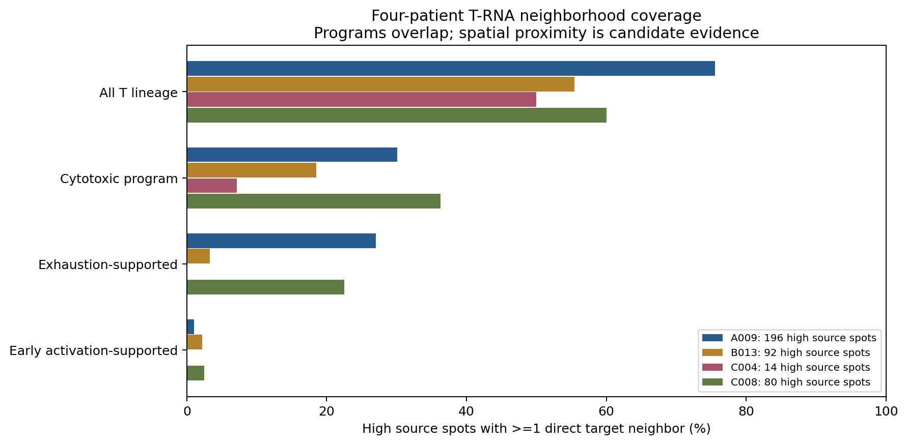

# GSE281759：PGAM5 高表达巨噬 RNA 邻域中的 T 细胞程序

本分析聚焦现有数据能够识别的三类 T 细胞 RNA 程序：细胞毒、耗竭支持、早期活化。**细胞毒程序最常见，但没有证据证明任何一类对 PGAM5 高表达巨噬细胞具有特异互作。**这是混合细胞 Visium 位点的空间候选分析，不是单细胞通讯或因果证明；源位点的 PGAM5 也不能确定来自巨噬细胞。

## 范围与主要结果

4 位患者（A009、B013、C004、C008），16 张肿瘤切片，25,354 个 QC 位点。C004 原发与复发属于同一患者；排除 A009N。382 个 PGAM5-high 巨噬 RNA 源均有空间邻居。未经病理 ROI 分割，肿瘤切片不代表每个位点都是恶性区域。

| T RNA 类别 | 全部目标位点 | 有直接邻居的高表达源 | 源覆盖率 |
|---|---:|---:|---:|
| T 谱系基线 | 4,004 | 254/382 | 66.5% |
| 细胞毒程序 | 733 | 106/382 | 27.7% |
| 耗竭支持程序 | 465 | 74/382 | 19.4% |
| 早期活化支持程序 | 74 | 6/382 | 1.6% |

类别可重叠，覆盖率不能相加，也不是细胞比例或通讯概率。细胞毒程序不能直接称为 CD8 T。稀少活化信号不代表没有活化 T 细胞。

| 患者 | 高表达源数 | 细胞毒覆盖率 | 耗竭覆盖率 |
|---|---:|---:|---:|
| A009 | 196 | 30.1% | 27.0% |
| B013 | 92 | 18.5% | 3.3% |
| C004 | 14 | 7.1% | 0.0% |
| C008 | 80 | 36.2% | 22.5% |

患者差异明显。患者是独立生物学单位；合并位点比例仅描述。`patient_equal_section_effects.csv` 保存各患者可检验切片的等权效应中位数与切片数，不能视为总体患者显著性检验。未将切片、位点或边数充当独立患者。

## 门控与空间统计

沿用固定主 QC：in_tissue=1、UMI≥500、基因≥200、MT≤25%。原论文 MT≤5%，未完成全部 MT5 敏感性分析。归一化采用全部 36,601 features 的 UMI 分母，未对 179-marker 子集重新归一化。

巨噬核心 C1QA/B/C、CD68、CSF1R、MERTK、MSR1 平均 log1p(CP10k)≥切片 Q75、≥3 基因检出，且 Pan-myeloid≥切片中位数。PGAM5-high 为巨噬门内 PGAM5 检出源的表达≥Q75，保留并列；主对照为其他 PGAM5 检出巨噬源，未检出仅辅助描述。

T 谱系为 CD3D/E/G、TRAC、TRBC1/2，分数≥切片 Q75 且≥2标志。T 状态均在 T 门内要求分数≥T 门 Q75、>0、≥2状态标志：

- 细胞毒：IFNG、PRF1、GZMB、GZMA、CCL5、TBX21。
- 耗竭支持：PDCD1、LAG3、TIGIT、CTLA4、TOX、CXCL13。
- 早期活化支持：CD69、IL2RA、TNFRSF9、ICOS、CD40LG、IL2。

直接邻接为真实 Visium 六边格第一圈六方向，无自环，每源最多六邻居。组织图使用真实像素坐标、原缩放系数及 H&E，未使用 UMAP 距离。`high_source_T_neighbor_edges.csv.gz` 保存三类状态的高表达源→目标邻接边。

本轮聚焦汇总上一轮预设空间统计，不根据本轮结果重新设阈值或缩小 FDR 家族。每切片每类别4,999次条件标签置换，层为3×3空间粗区块×源UMI二分位×巨噬核心二分位，保持层内高标签数，双侧等尾+1校正。high<5、对照<10或恒定零分布标不可检验。主比较高表达 vs 其他检出保留原144项 BH，三种比较保留原432项联合 BH，另保留排除复发的135项 BH；缺失检验只在校正时计1。**本轮 T 类别没有 q<0.05。**条件层不能完全消除空间自相关、共享邻居或混合细胞比例影响，不显著也不证明不存在作用。

## 重叠与候选配体–受体

`exclusive_T_program_combinations.csv` 将 T 门目标分成三种状态的八种互斥组合，仅作描述。不满足三种状态的 T 门不能叫初始/记忆 T。目标组合互斥，但同一源可有多个不同组合邻居，因此源覆盖数仍不可相加。

候选 LR 表复用前轮 LIANA 1.10.0 资源定义及逐实际邻接边检出：源配体计数>0、目标所有受体亚基>0。包括 SPP1–CD44、PVR/NECTIN2–TIGIT 等。每条边可共享源/目标，边数不是独立样本。检出率分母不同不能直接排名通路强弱；TIGIT/PDCD1 等参与耗竭门控，不能把共检出当作独立耗竭验证。目标混合 RNA 中受体也不能确定来自 T 细胞。未运行 CellChat/LIANA 通讯显著性算法，PGAM5 为细胞内蛋白，未当作配体。

## 图表



- [逐切片高表达与其他检出差异](figures/section_T_program_difference.png)
- [T 状态组合](figures/T_program_overlap.png)
- [候选 LR 共检出](figures/T_candidate_LR_codetection.png)
- H&E 空间图：[A009](figures/A009_T_spatial_maps.png)、[B013](figures/B013_T_spatial_maps.png)、[C004](figures/C004_T_spatial_maps.png)、[C008](figures/C008_T_spatial_maps.png)。

共8组 PNG/PDF。红色空心圈为 PGAM5-high 巨噬 RNA 源，实色点为 T 程序目标，连线为实际直接邻接。

## 如何补充 CD4/CD8、Treg、初始/记忆标志

目前工作区只有179-marker表达子集，原始全基因矩阵不在本地；NCBI 下载受环境网络限制。**需要恢复全基因表达矩阵，检查真实检测情况，不能人为填入基因表达或标签。**原始附件来源及 SHA 见基础目录 `source_manifest.json`。补齐基因后应从原始矩阵按原全库分母重建对象，保留真实坐标、QC、患者范围及既定源门。

| 目标 | 补充候选基因 |
|---|---|
| CD4 T | CD4、IL7R、LTB；结合 CD3D/E、TRAC |
| CD8 T | CD8A、CD8B；结合 CD3D/E、TRAC |
| Treg | FOXP3、IL2RA、CTLA4、IKZF2、TIGIT |
| 初始 T | CCR7、SELL、TCF7、LEF1、MAL |
| 中央记忆 T | CCR7、IL7R、LTB、TCF7 |
| 效应记忆 T | GZMK、CCL5、IL7R，结合相对较低 CCR7/SELL 程序 |

这些是候选标志，单基因不充分；IL2RA/CTLA4 可来自活化 T，CD4 可来自髓系，CD8A 可来自 NK，初始与中央记忆程序重叠。建议采用组织匹配的单细胞参考（含明确患者、细胞注释）进行空间反卷积，检查参考覆盖、批次和标志一致性，按患者汇总并预设新增检验家族。RNA 位点仍不是已验证单细胞身份。

## 来源、复现与核验

GEO：[GSE281759](https://www.ncbi.nlm.nih.gov/geo/query/acc.cgi?acc=GSE281759)。使用仓库已有数据，未声称重新下载。基础输入在相邻 `GSE281759_spatial_HCC_PGAM5`；邻域统计、注释及置换零分布在 `GSE281759_PGAM5_immune_subgroup_neighbors`。基准仓库提交 `76883c5cbbde45c1ad16473057e81ec7752a7f10`。输入 SHA 见 `input_manifest.json`。

本轮独立按图重新统计所有切片、三组源、四类 T 目标的分母及覆盖数，并核对八组合分区；结果见 `audit_results.json`。来源全分析审核记录（4,120项）随包保留为 `source_audit_results.json`，该记录来自前轮，不是本轮重新运行的全审核。

```bash
git clone https://github.com/183285068-droid/codex.git
cd codex
python -m venv /tmp/gse281759_tenv
. /tmp/gse281759_tenv/bin/activate
pip install -r results/GSE281759_PGAM5_Tcell_subgroups/requirements.txt
OPENBLAS_NUM_THREADS=1 python results/GSE281759_PGAM5_Tcell_subgroups/analyze_visualize.py
python results/GSE281759_PGAM5_Tcell_subgroups/package_results.py
```

结果包包含本轮图表、表格、源–目标边、代码、审核和说明；已有基线 AnnData、上一轮注释和置换零分布不重复打包，复现从同仓库读取。包内 manifest 验证每文件 SHA。
