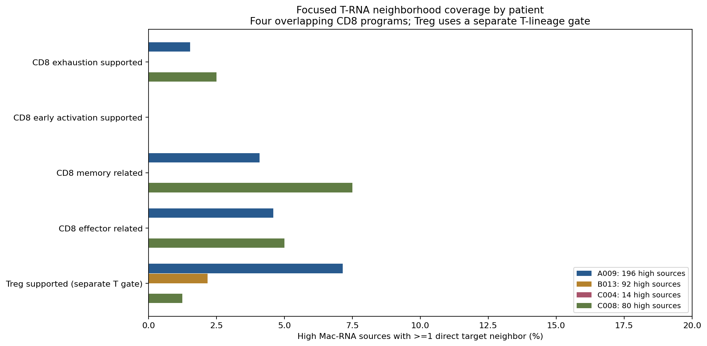

# GSE281759：聚焦 CD8 四类程序与独立 Treg 支持程序

**本轮按用户要求收敛为五类：CD8耗竭、早期活化、记忆、效应相关RNA程序，以及独立Treg支持程序。未发现任何类别具有统计显著的PGAM5-high特异邻接。**分类采用既有门的预设并集，保留重叠，不进行过细组合的亚群命名，也不以显著性重设阈值。

GSE281759为Visium混合细胞位点。这些是多基因RNA程序及空间邻近候选，不能确定标志来自同一细胞、源PGAM5来自巨噬细胞，或存在真实功能互作。Treg通常为CD4谱系，但本轮Treg RNA门不等同于已确认的CD4 Treg；不将其强制纳入CD8父门，也不把CD8/Treg标志共现解释为CD8调节性细胞。

## 系统分类

沿用完整全基因矩阵派生、已核验的对象、原QC和源门。4位患者、16张肿瘤切片、25,354个QC位点；C004原发/复发属于同一患者，B0013/B013统一为B013，排除A009N。未分割病理恶性ROI。主QC为in_tissue=1、UMI≥500、基因≥200、MT≤25%；原论文MT≤5%，本轮未重做MT5全敏感性分析。

巨噬源为核心程序≥切片Q75、≥3核心标志、Pan-myeloid≥切片中位数；PGAM5-high为门内PGAM5检出源表达≥检出源Q75，保留并列。382个high源、1,122个有空间邻居的其他检出源。未检出不等于没有表达。归一化用完整36,601-feature矩阵全库UMI，未使用子集库大小。

CD8父门固定为既有T门（CD3D/E/G、TRAC、TRBC1/2，≥全片Q75且≥2标志）内CD8A/B同时检出、二者平均表达≥T门Q75且>0，共193个RNA位点。所有CD8子程序复用之前的固定门：分数为含零值平均log1p(CP10k)，≥本片CD8父门Q75且>0，另有检出数及锚点；完整标志规则见[前轮细分配置](../GSE281759_PGAM5_CD8_fine_programs/analysis_config.json)。

| 主类群 | 组成与定义 |
|---|---|
| CD8耗竭支持 | 通用耗竭支持、祖细胞耗竭样、终末耗竭样的并集；包含PDCD1/TOX/LAG3/TIGIT/HAVCR2/ENTPD1等程序，祖细胞候选需要TCF7和PDCD1。 |
| CD8早期活化支持 | 既有CD69/IL2RA/TNFRSF9/ICOS/CD40LG/IL2程序，≥2状态标志及CD69或IL2RA或TNFRSF9或ICOS锚点。未把增殖或IFN响应直接当作活化证明。 |
| CD8记忆相关 | 中央记忆样（CCR7/IL7R/LTB/TCF7）、GZMK记忆样（GZMK/IL7R/CCL5）、驻留记忆样（CD69/ITGAE/CXCR6/ZNF683/ITGA1/RGS1）的并集；未把初始样门直接加入并集，但允许初始/记忆RNA标志重叠。 |
| CD8效应相关 | 细胞毒效应（NKG7/PRF1/GZMB/GNLY/CTSW/CCL5）及终末效应样（FGFBP2/CX3CR1/GZMH/PRF1/NKG7/KLRG1）的并集。 |
| Treg支持（独立T门） | 既有T谱系门内FOXP3/IL2RA/CTLA4/IKZF2/TIGIT程序≥T门Q75且>0，≥2标志且FOXP3检出；不要求属于CD8门。 |

四种CD8程序是状态轴而非互斥身份，记忆–效应及耗竭–效应可共现。并集只改变本轮汇总层级，没有改动原子程序门。尚无单细胞参考反卷积、蛋白或功能验证；早期活化门不穷尽所有活化机制，FOXP3等亦可能来自活化或混合T RNA，不证明抑制功能。

## 结果与分母

| 类别 | 全队列目标 | high邻近独立目标 | 有该类邻居的high源 | high源覆盖率 |
|---|---:|---:|---:|---:|
| CD8耗竭支持 | 19 | 5 | 5/382 | 1.3% |
| CD8早期活化支持 | 8 | 0 | 0/382 | 0.0% |
| CD8记忆相关 | 51 | 13 | 14/382 | 3.7% |
| CD8效应相关 | 32 | 11 | 13/382 | 3.4% |
| Treg支持 | 126 | 18 | 17/382 | 4.5% |

目标和源是不同分母，标签可重叠，不能相加。Treg目标不使用CD8父门分母，不能与CD8子程序比例拼成总和。49个CD8父门目标邻近high源，其中18个位点至少支持四程序之一、31个位点未满足四门；后者可能支持本轮未纳入的增殖/IFN等程序，也可能受低检出影响，**不标为初始、静息或无功能**。全队列193个CD8父门中76满足至少一个四程序，117未满足。组合仅描述，不追加事后检验。

## 患者比较

| 患者 | high源 | 耗竭% | 早期活化% | 记忆% | 效应% | Treg% |
|---|---:|---:|---:|---:|---:|---:|
| A009 | 196 | 1.5 | 0.0 | 4.1 | 4.6 | 7.1 |
| B013 | 92 | 0.0 | 0.0 | 0.0 | 0.0 | 2.2 |
| C004 | 14 | 0.0 | 0.0 | 0.0 | 0.0 | 0.0 |
| C008 | 80 | 2.5 | 0.0 | 7.5 | 5.0 | 1.2 |

患者是独立生物学单位，切片、位点或共享邻接边不增加病例数。表为患者描述；另保存可检验切片等权效应中位数及切片数，没有将合并位点进行普通t/Wilcoxon病例总体检验。C004仅1个CD8父门位点和14个high源，不能将零覆盖解读成不存在这些细胞。

## Treg身份敏感性

126个Treg支持目标中，13个同时满足CD4相关RNA门，其中4个邻近high源，覆盖4个high源。另有10个与CD8父门重叠，其中1个邻近high源，覆盖1个high源。这些是同位点混合RNA，**不证明CD8 Treg**。未同时满足CD4门亦不证明不属于CD4，可能是dropout或严格门控。两种交集仅描述，不用于事后选显著亚组或替代主Treg门。

## 空间统计与LR

真实Visium第一圈六方向邻接，每源最多6邻居，无自环。统计量为high源有≥1该类邻居比例减对照比例，单位百分点。每片每类4,999次条件标签置换，层为全片3×3粗空间区块×当前源UMI二分位×巨噬核心二分位，保留层内high数；双侧等尾p含+1校正，不假定零分布中心为0。high<5、对照<10或恒定零分布则不可检验。

按用户新的聚焦范围预设5×16=80项主家族（high vs other detected），加high vs all other mac及排除T富集源的high vs other detected共240项联合家族；排除复发另75项主BH。不可检验p缺失、只在校正时计1。该家族收敛不表示对既往所有分析重新校正，也不据较小家族夸大证据。种子281759502+GSM数字部分。

主80项23可检验、57不可检验，另外两比较27及16可检验。**主最小p=.2216，主、联合及原发限定最小q均为1.0，未发现特异邻接。**粗分层不能完全消除空间自相关、共享目标和混合RNA混杂；未显著不证明不存在真实作用。

候选LR复用LIANA1.10.0快照21对定义，统计high源→真实邻接目标的配体原始计数>0、受体所有亚基>0；PGAM5不作为配体。不同类别分母不同、源目标及边可共享，不能将共检出率当通路强度或独立样本。受体可能参与门控或来自其他混合细胞，未运行CellChat/LIANA通讯显著性算法，未证明功能方向或PGAM5机制。

## 可视化



- [逐片差异](figures/section_focused_T_differences.png)、[标志证据](figures/focused_T_marker_evidence.png)。
- [四类CD8组合](figures/CD8_four_program_combinations.png)、[五类重叠](figures/focused_T_overlap.png)、[候选LR](figures/focused_T_LR_codetection.png)。
- H&E真实空间图：[A009](figures/A009_focused_T_spatial_maps.png)、[B013](figures/B013_focused_T_spatial_maps.png)、[C004](figures/C004_focused_T_spatial_maps.png)、[C008](figures/C008_focused_T_spatial_maps.png)。

共10组PNG/PDF。红圈high巨噬RNA源、蓝点目标、线为实际邻接。使用原像素坐标与缩放，不使用UMAP距离。定义marker点图不是独立身份验证；n=0留空，LR无边为NA。

## 来源、复现与核验

GEO：[GSE281759](https://www.ncbi.nlm.nih.gov/geo/query/acc.cgi?acc=GSE281759)。源仓库提交`ec913984a648b113565ad2fa1757372f351b2673`。复用已与用户上传全基因矩阵计数、UMI及SHA核验一致的细分CD8及扩展T对象；32个本轮父输入的SHA/大小见`reference_manifest.json`。未再次改变QC或完整矩阵归一化。原始输入来源与SHA见前轮目录。

288项共享计数、归一化和显式邻居遍历通过；另2,111项独立输入SHA、并集/Treg重建、格邻接、源门、身份敏感性、LR、置换p及BH检查通过。检查结果分别为`audit_results.json`及`independent_audit_results.json`。人工查看患者覆盖、标志和真实空间图，审核不替代细胞归属验证。

每片`*_focused_T_markers.h5ad`保存必要计数、全库归一化、门控与空间图，非完整全基因对象；父输入、H&E与基础对象从同仓库读取。结果包保存本轮图、逐位点注释、邻接边、患者汇总、敏感性、置换零分布、LR、审核及代码。

```bash
git clone https://github.com/183285068-droid/codex.git
cd codex
python -m venv /tmp/gse281759_Tfocused_env
. /tmp/gse281759_Tfocused_env/bin/activate
pip install -r results/GSE281759_PGAM5_Tcell_systematic/requirements.txt
OPENBLAS_NUM_THREADS=1 python results/GSE281759_PGAM5_Tcell_systematic/analyze.py
OPENBLAS_NUM_THREADS=1 python results/GSE281759_PGAM5_Tcell_systematic/plot.py
OPENBLAS_NUM_THREADS=1 python results/GSE281759_PGAM5_Tcell_systematic/audit.py
python results/GSE281759_PGAM5_Tcell_systematic/package_results.py
```
