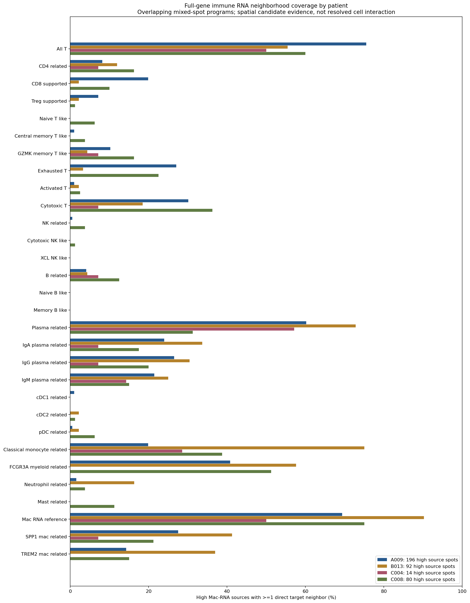

# GSE281759：全基因矩阵扩展 PGAM5-high 巨噬 RNA 的免疫邻域

**已在恢复的完整计数矩阵中检查30类免疫相关RNA目标。浆细胞相关、FCGR3A髓系相关和经典单核相关区域是较常见的邻近候选；NK、pDC、粒细胞及肥大细胞等也有少量符合门控的邻近位点。没有类别显示多重校正后的PGAM5-high特异邻接。**

这里的“候选”是混合Visium位点的空间RNA证据，不是已确认的单细胞亚群、细胞比例或功能互作。源PGAM5、目标标志及受体都不能确定来自同一指定细胞。标签可重叠；比例不能相加，也不能仅按邻近频率认定特异富集。

## 数据与范围

使用用户上传的16张肿瘤切片全基因计数矩阵，每片36,601 features，matrix/features/barcodes共48文件按既有NCBI文件大小及SHA256核验。A009T4/T5矩阵由分卷拼接。条形码、全库UMI及179个原有marker计数与空间基线完全一致；本轮所用基因在每片features表中唯一映射。未重新从NCBI下载，也未人工补造表达。

4位患者、16张肿瘤切片（15原发、1复发）、25,354个QC位点。A009N非肿瘤切片排除；B0013/B013统一为B013；C004T1P/R为同一患者。未经病理ROI分割，不能解释成全部位点为恶性组织。

固定源门及QC保持原定义：in_tissue=1、UMI≥500、检出基因≥200、MT≤25%。原论文MT≤5%，本轮未复算完整MT5敏感性。巨噬核心C1QA/B/C、CD68、CSF1R、MERTK、MSR1的平均log1p(CP10k)≥全片Q75、≥3标志检出，且Pan-myeloid（LST1/TYROBP/FCER1G/AIF1/LYZ/CTSS）≥全片中位数。PGAM5-high为巨噬门内PGAM5检出源表达≥检出源Q75，保留并列；不在免疫邻域内重设阈值。

382个high源全部有空间邻居，主对照1,122个有邻居的其他PGAM5检出巨噬RNA源；未检出仅辅助，不能称为没有PGAM5。所有CP10k使用完整全库UMI，未对本轮marker子集重新归一化。

## 30类RNA目标与门控

15个参考/既有门保持不变，15个新门采用预设多基因规则。新门分数为所列基因平均log1p(CP10k)，含零值，≥指定父门/全QC的Q75且>0，同时要求最少标志数及锚点。父门为空时目标为空，阈值缺失，不填0。程序、锚点、随机种子在统计前写入`analysis_config.json`。

### 沿用的15个门

- T谱系（CD3D/E/G、TRAC、TRBC1/2）：全片Q75、≥2标志。
- 原耗竭支持（PDCD1/LAG3/TIGIT/CTLA4/TOX/CXCL13）、早期活化（CD69/IL2RA/TNFRSF9/ICOS/CD40LG/IL2）、细胞毒（IFNG/PRF1/GZMB/GZMA/CCL5/TBX21）均限定T门、T门内Q75、>0、≥2状态标志。细胞毒T不自动等于CD8。
- CD4相关（CD4/IL7R/LTB，≥2且CD4）、CD8支持（CD8A/B同时检出）、Treg支持（FOXP3/IL2RA/CTLA4/IKZF2/TIGIT，≥2且FOXP3）、初始T样（CCR7/SELL/TCF7/LEF1/MAL，≥3且CCR7或SELL及TCF7或LEF1）、中央记忆T样（CCR7/IL7R/LTB/TCF7，≥3且CCR7和IL7R）、GZMK记忆T样（GZMK/CCL5/IL7R，≥2且GZMK及CCL5或IL7R），均复用前轮T门内Q75规则。GZMK门对应前轮`Effector_memory_like`，本轮改用更谨慎名称，未重定义其目标。
- B相关（MS4A1/CD79A/B/CD19/CD22，≥2且MS4A1或CD19）、浆细胞相关（MZB1/JCHAIN/SDC1/IGKC，≥3且MZB1或JCHAIN）、cDC1（CLEC9A及XCR1同时检出）、cDC2（CD1C/FCER1A/CLEC10A，≥2且CD1C或CLEC10A）复用全片Q75、>0门。
- 巨噬RNA参考门完全复用源的巨噬核心门，包含high和其他巨噬RNA位点，作为邻域参考。

### 新增15个门

| RNA目标 | 基因 | 父门 | 最少检出 | 额外锚点 |
|---|---|---|---:|---|
| NK相关 | NCR1/NCR3/NCAM1/KLRD1/NKG7/GNLY | 全QC | 3 | NCR1或NCR3或NCAM1 |
| 细胞毒NK样 | FGFBP2/FCGR3A/PRF1/GNLY/NKG7/KLRD1 | NK | 3 | PRF1或GNLY |
| XCL NK样 | XCL1/XCL2/KLRC1/NCAM1/KLRD1 | NK | 2 | XCL1或XCL2 |
| 初始B样 | TCL1A/IGHD/IL4R/FCER2/BANK1 | B | 2 | TCL1A或IGHD |
| 记忆B样 | CD27/TNFRSF13B/CD37/AIM2/MS4A1/CD79A | B | 3 | CD27和TNFRSF13B |
| IgA浆细胞相关 | IGHA1/IGHA2/JCHAIN/MZB1 | 浆细胞 | 2 | IGHA1或IGHA2 |
| IgG浆细胞相关 | IGHG1/2/3/4/MZB1 | 浆细胞 | 2 | 任一IGHG |
| IgM浆细胞相关 | IGHM/JCHAIN/MZB1 | 浆细胞 | 2 | IGHM |
| pDC相关 | TCF4/IL3RA/CLEC4C/IRF7/LILRA4/GZMB | 全QC | 3 | CLEC4C或LILRA4，且TCF4或IL3RA |
| 经典单核相关 | FCN1/CD14/VCAN/S100A8/S100A9/LST1 | 全QC | 3 | FCN1或CD14，且Pan-myeloid≥全片中位数 |
| FCGR3A髓系相关 | FCGR3A/MS4A7/LILRB1/LST1/CTSS | 全QC | 3 | FCGR3A且MS4A7或LILRB1，且Pan-myeloid≥全片中位数 |
| 中性粒细胞相关 | FCGR3B/CSF3R/CXCR2/FPR1/S100A8/S100A9/S100A12 | 全QC | 3 | FCGR3B或CSF3R或CXCR2 |
| 肥大细胞相关 | KIT/TPSAB1/TPSB2/CPA3/MS4A2/HDC | 全QC | 3 | TPSAB1或TPSB2，且CPA3或KIT |
| SPP1巨噬相关 | SPP1/TREM2/APOE/LPL/GPNMB/LGALS3 | 巨噬参考门 | 3 | SPP1 |
| TREM2巨噬相关 | TREM2/APOE/LPL/GPNMB/CST7 | 巨噬参考门 | 3 | TREM2 |

NK程序可能与T/髓系或其他混合RNA重叠，不标CD56bright/dim；FCGR3A髓系不能自动称为已确定的非经典单核细胞。SPP1/TREM2标签不是M1/M2极化证明；IgA/G/M共现不证明同一浆细胞类别转换或克隆；记忆/初始B和T门不是成熟的参考注释。严格锚点、低检出和dropout可能漏检真实类别，零目标不代表没有细胞。仍未运行单细胞参考反卷积或蛋白验证，本轮30类并非免疫细胞全部类型的穷尽注释。

## 主要空间邻接结果

源覆盖分母固定382个high源。独立目标数按“切片+barcode”去重；源数和目标数不同。以下类别及父子门可重叠，不可相加。

| 目标RNA类别 | 全队列目标 | high邻近独立目标 | 有该类邻居的high源 | 覆盖率 |
|---|---:|---:|---:|---:|
| 巨噬RNA参考 | 4,091 | 716 | 286 | 74.9% |
| T谱系参考 | 4,004 | 524 | 254 | 66.5% |
| 浆细胞相关 | 3,064 | 506 | 218 | 57.1% |
| FCGR3A髓系相关 | 1,552 | 281 | 174 | 45.5% |
| 经典单核相关 | 1,702 | 264 | 143 | 37.4% |
| SPP1巨噬相关 | 769 | 151 | 110 | 28.8% |
| 细胞毒T | 733 | 127 | 106 | 27.7% |
| IgG浆细胞相关 | 772 | 158 | 97 | 25.4% |
| IgA浆细胞相关 | 698 | 144 | 93 | 24.3% |
| IgM浆细胞相关 | 521 | 107 | 79 | 20.7% |
| 耗竭支持T | 465 | 91 | 74 | 19.4% |
| TREM2巨噬相关 | 447 | 99 | 74 | 19.4% |
| CD8支持 | 193 | 49 | 49 | 12.8% |
| CD4相关 | 346 | 54 | 41 | 10.7% |
| GZMK记忆T样 | 296 | 46 | 38 | 9.9% |
| B相关 | 185 | 20 | 23 | 6.0% |
| 中性粒细胞相关 | 204 | 22 | 21 | 5.5% |
| Treg支持 | 126 | 18 | 17 | 4.5% |
| 肥大细胞相关 | 70 | 9 | 9 | 2.4% |
| pDC相关 | 57 | 8 | 8 | 2.1% |
| 早期活化T | 74 | 6 | 6 | 1.6% |
| 初始T样 | 26 | 4 | 5 | 1.3% |
| 中央记忆T样 | 48 | 4 | 5 | 1.3% |
| NK相关 | 56 | 4 | 4 | 1.0% |
| cDC2相关 | 70 | 3 | 3 | 0.8% |
| cDC1相关 | 3 | 1 | 2 | 0.5% |
| 细胞毒NK样 | 15 | 1 | 1 | 0.3% |
| XCL NK样 | 3 | 0 | 0 | 0.0% |
| 初始B样 | 14 | 0 | 0 | 0.0% |
| 记忆B样 | 1 | 0 | 0 | 0.0% |

“经典单核相关”是新FCN1/CD14程序，不是原来的炎症单核门，不能将其与旧结果的29.3%直接解释成变化。浆细胞、B、T等原门的描述计数保持一致。巨噬目标可能自身也属于PGAM5-high，且无自环；去除所有high目标的辅助描述中，巨噬参考/SPP1/TREM2分别覆盖279、102、69个high源，见`macrophage_targets_excluding_high_descriptive.csv`。这不代表分辨出了不同细胞间功能作用。

## 患者层面

| 患者 | high源 | 浆细胞% | FCGR3A髓系% | 经典单核% | SPP1巨噬% | 细胞毒T% | NK% | pDC% | 中性粒% | 肥大细胞% |
|---|---:|---:|---:|---:|---:|---:|---:|---:|---:|---:|
| A009 | 196 | 60.2 | 40.8 | 19.9 | 27.6 | 30.1 | 0.5 | 0.5 | 1.5 | 0.0 |
| B013 | 92 | 72.8 | 57.6 | 75.0 | 41.3 | 18.5 | 0.0 | 2.2 | 16.3 | 0.0 |
| C004 | 14 | 57.1 | 0.0 | 28.6 | 7.1 | 7.1 | 0.0 | 0.0 | 0.0 | 0.0 |
| C008 | 80 | 31.2 | 51.2 | 38.8 | 21.2 | 36.2 | 3.8 | 6.2 | 3.8 | 11.2 |

患者是独立生物学单位，切片、位点或共享邻接边不能扩增病例数。表格是同患者汇总描述，`patient_equal_section_effects.csv`保留可检验切片的等权效应中位数与切片数；没有使用合并位点进行伪独立的患者总体t/Wilcoxon检验。C004仅14个high源，稀少类别的跨患者推断受限。

## 条件空间统计

真实Visium六边格第一圈六方向，每源最多6邻居，无自环。每片每类别统计“high源有≥1该类邻居”的比例减对照比例（百分点）。4,999次条件标签置换保留3×3粗空间区块×当前源UMI二分位×巨噬核心二分位的high标签数；双侧等尾p含+1校正，不假定条件零分布中心为0。high<5、对照<10或恒定零分布标不可检验。

主家族30×16=480项（high vs other detected）；另外两比较为high vs all other mac和排除同时T富集源的high vs other detected，共1,440项联合家族。另提供排除复发的450项主BH。不可检验p保留缺失，仅在家族校正时计1。这是本轮完整预设探索家族，不对整个项目历史检验提供联合FDR保证；既有类别本轮也在480家族内重新校正，置换种子更新为预设281759402+GSM数字部分，名义Monte Carlo p可能略变。

主480项229可检验、251不可检验；另外两比较291和167可检验。**主480、联合1440及原发限定450家族最小q均为1.0，无q<0.05。**三个名义p<0.05主结果均为负方向：A009T1 TREM2巨噬（p=.0188）、A009T4中性粒（p=.0484）、B013T5 T谱系（p=.006），校正均q=1，不能称为稳定富集或保护机制。

粗分层不能完全消除空间自相关、共享目标和混合RNA比例影响；排除T源敏感性不是纯化巨噬细胞。缺少显著性不证明不存在真实生物学互作。目标另分high邻近（可同时邻近其他检出源）、仅其他检出源邻近、两类均不邻近的三个互斥区；最后一类仍可能邻近未检出源，不等于远离巨噬细胞。分区表仅描述，未新增事后目标分区检验。

## 候选配体–受体

复用保存的LIANA1.10.0资源定义21对候选，仅统计PGAM5-high源→实际邻接目标，要求配体原始计数>0、目标所有复合受体亚基>0；保存边、独立源/目标分母和支持数量。PGAM5是细胞内蛋白，未当配体。

源与目标可共享，边不是独立样本；类别间分母不同，不能把共检出率直接解释为通路强弱。受体可能来自目标混合位点的其他细胞，某些受体参与门控，不能当独立身份或耗竭验证。未运行CellChat/LIANA通讯显著性算法，也未证明蛋白结合、方向性功能或PGAM5介导机制。完整结果见`candidate_LR_codetection.csv`，实际源–目标边见`high_source_immune_directed_edges.csv.gz`。

## 可视化



- [逐切片高表达与其他检出差异](figures/section_immune_differences.png)。
- [独立目标邻域分区](figures/immune_unique_target_zones.png)、[目标程序重叠比例](figures/immune_program_overlap.png)。
- [high邻近目标标志证据](figures/high_near_immune_marker_evidence.png)：定义标志，不是独立注释验证。
- [21对候选LR共检出](figures/immune_LR_codetection.png)：无边为NA而非0。
- H&E真实空间图：[A009](figures/A009_immune_spatial_maps.png)、[B013](figures/B013_immune_spatial_maps.png)、[C004](figures/C004_immune_spatial_maps.png)、[C008](figures/C008_immune_spatial_maps.png)。空间图展示主要谱系，全部30程序在覆盖/差异/重叠/LR图及逐位点表中保留。

共10组PNG/PDF。红圈high源，实色为可重叠目标，线为真实直接邻接。坐标、H&E和缩放来自原Visium基线，不使用UMAP距离。

## 来源、复现及核验

GEO：[GSE281759](https://www.ncbi.nlm.nih.gov/geo/query/acc.cgi?acc=GSE281759)。源仓库提交`064f1251eb803ff58025f202532b3ddbdd3c261c`。48个原始附件及SHA见`input_manifest.json`；空间基线、旧目标及前轮扩展T父门的文件SHA见`reference_manifest.json`。程序核验包括原始来源、全库UMI、旧marker计数、固定父门、真格邻接、实际源目标边、门控、LR复合亚基、条件置换p及BH；结果见`audit_results.json`与`independent_audit_results.json`。

原始来源与显式邻居遍历1,520项检查通过；独立审核14,940项全部通过，另验证所有新门、保持的旧门、源门、目标分区、边、排除high的巨噬目标敏感性及统计。审核不能替代单细胞归属和生物学验证。人工检查患者图、marker图及空间图；图表实际分母保留到CSV。

每片`*_immune_markers.h5ad`保存本轮所需RNA计数、全库归一化、注释及空间图，**不是完整全基因对象**。大体积原始矩阵不重复推送GitHub，可由用户原始附件或基础下载脚本按SHA恢复；空间图像及父门从同仓库既有目录读取。包内含本轮所有图、统计、患者汇总、边、审核和代码。

```bash
git clone https://github.com/183285068-droid/codex.git
cd codex
python -m venv /tmp/gse281759_immune_env
. /tmp/gse281759_immune_env/bin/activate
pip install -r results/GSE281759_PGAM5_immune_fullgene/requirements.txt
export GSE281759_INPUT_DIR="/你的48个原始附件目录"
OPENBLAS_NUM_THREADS=1 python results/GSE281759_PGAM5_immune_fullgene/analyze.py
OPENBLAS_NUM_THREADS=1 python results/GSE281759_PGAM5_immune_fullgene/plot.py
OPENBLAS_NUM_THREADS=1 python results/GSE281759_PGAM5_immune_fullgene/audit.py
python results/GSE281759_PGAM5_immune_fullgene/package_results.py
```

本轮解决原179基因子集缺少NK/pDC/粒细胞等标志的问题，仍受混合位点归属、严格门控及4位患者样本量限制。进一步确认免疫细胞身份及功能需匹配的单细胞参考/空间反卷积、细胞分辨率或独立实验数据。
