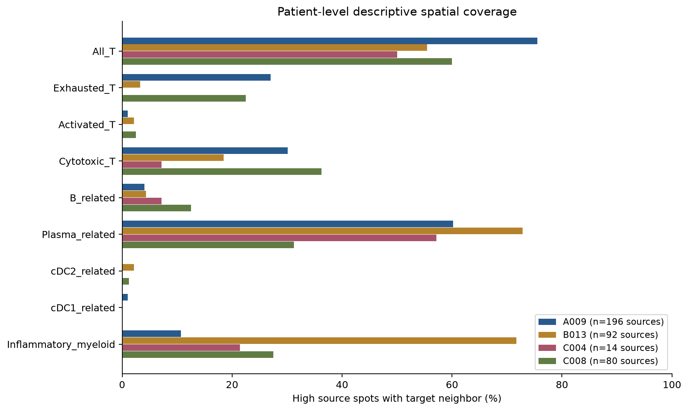

# GSE281759：PGAM5高表达巨噬细胞相关区域的免疫亚群空间邻域

**浆细胞相关 RNA 区域是本队列最常见的空间邻近候选；炎症单核/髓系和细胞毒 T 相关区域次之。没有类别通过 PGAM5-high 相对其余检出巨噬区域的多重校正差异检验，不能认定任何亚群与 PGAM5-high 巨噬细胞存在特异互作。**

GSE281759 是 10x Visium 空间转录组，当前分析单位是混合细胞的组织位点。PGAM5 与巨噬标志共现不能确定 PGAM5 来自巨噬细胞；目标多基因标签也不能确认单个免疫细胞身份。本文“候选”指空间邻近的 RNA 特征区域，配体–受体结果仅是邻接位点 RNA 共检出。PGAM5 是细胞内蛋白，本轮没有将 PGAM5 当作配体。

## 主要结果

4 位患者、16 张肿瘤切片（15 原发、1 复发），25,354 个 QC 位点、4,091 个巨噬 RNA 富集位点；PGAM5-high 382 个，其他检出且有空间邻居 1,122 个，未检出且有邻居 2,580 个。全部 382 个高表达源均有空间邻居。下表各目标可重叠，来源按每类别去重，不能相加；比例不是细胞浸润量或通讯概率。

| RNA目标类别 | 目标位点 | 有该类直接邻居的高表达源 | 比例 |
| --- | ---: | ---: | ---: |
| 全部T谱系（基线） | 4,004 | 254/382 | 66.5% |
| 浆细胞相关 | 3,064 | 218/382 | 57.1% |
| 炎症单核/髓系相关 | 1,069 | 112/382 | 29.3% |
| 细胞毒T相关 | 733 | 106/382 | 27.7% |
| 耗竭支持T相关 | 465 | 74/382 | 19.4% |
| B细胞相关 | 185 | 23/382 | 6.0% |
| 早期活化支持T相关 | 74 | 6/382 | 1.6% |
| cDC2相关 | 70 | 3/382 | 0.8% |
| cDC1相关 | 3 | 2/382 | 0.5% |

邻接频率受目标区域数量、组织结构及检测能力影响，不能仅按频率称为特异富集。cDC1 仅 3 个目标位点，极稀疏。细胞毒 T 程序并无 CD8A/B 标志支持，不能标成已确认的 CD8 T 细胞。

| 高表达源有邻居的比例 | A009（196源） | B013（92源） | C004（14源） | C008（80源） |
| --- | ---: | ---: | ---: | ---: |
| 浆细胞相关 | 60.2% | 72.8% | 57.1% | 31.2% |
| 炎症单核/髓系相关 | 10.7% | 71.7% | 21.4% | 27.5% |
| 细胞毒T相关 | 30.1% | 18.5% | 7.1% | 36.2% |
| 耗竭支持T相关 | 27.0% | 3.3% | 0.0% | 22.5% |

患者间差异明显，合并位点比例仅作描述。患者是独立生物学单位，多切片和位点不能扩大病例数。患者切片效应用等权中位数汇总，不报告把位点当患者的总体显著性。

## 可视化



- [逐切片邻接覆盖热图](figures/section_neighborhood_coverage.png)
- [高表达与其余检出源的比例差热图](figures/section_neighbor_differences.png)
- [候选配体–受体共检出热图](figures/candidate_LR_codetection.png)
- H&E 真实组织坐标图：[A009](figures/A009_immune_spatial_maps.png)、[B013](figures/B013_immune_spatial_maps.png)、[C004](figures/C004_immune_spatial_maps.png)、[C008](figures/C008_immune_spatial_maps.png)

所有图同时提供 PNG/PDF。红色空心圈是 PGAM5-high 巨噬相关 RNA 源；其他颜色为可重叠目标，灰线为源与目标的直接空间邻接。空间位置来自真实 Visium 像素坐标及原始缩放系数，不使用 UMAP 距离。

## 固定规则与统计

复用此前固定主 QC：in_tissue=1、UMI≥500、检出基因≥200、MT≤25%。来自全部 36,601 features 的库大小用于 CP10k、log1p，未用 179 marker 子集重新归一化。原论文 MT≤5% 与主规则不同，本轮未复算 MT5 全分析。尤其 MT 高的切片应谨慎解释。

源门为 C1QA/B/C、CD68、CSF1R、MERTK、MSR1 平均分≥切片 Q75、≥3 核心基因检出，同时 Pan-myeloid（LST1/TYROBP/FCER1G/AIF1/LYZ/CTSS）≥切片中位数。PGAM5-high 为此门内 PGAM5 原始计数>0、归一化表达≥检出源 Q75，保留阈值并列。阈值在排除空间孤立源前确定，保持与前轮一致。其他检出作主对照；未检出不等于不存在表达。邻接分析仅保留度数>0的源。

T谱系及耗竭、活化、细胞毒标签保持原定义：T门≥切片Q75、≥2谱系标志；状态均值≥T门Q75、>0、≥2状态标志。T状态可重叠。B、浆细胞、cDC2、cDC1、炎症髓系固定程序见 [analysis_config.json](analysis_config.json)，均值包含零值，分数≥全片Q75且>0；至少2标志检出，浆细胞至少3。另要求 B 检出 MS4A1或CD19、浆细胞检出 MZB1或JCHAIN、cDC2检出 CD1C或CLEC10A、cDC1同时检出 CLEC9A和XCR1、炎症髓系检出 FCN1或VCAN且 Pan-myeloid≥全片中位数。这些是候选 RNA 门控，尚未经单细胞参考反卷积或蛋白验证。完整标志检出率见 [marker_detection.csv](marker_detection.csv)。

直接邻接为 QC 后 Visium 六边格第一圈 (0,±2)、(±1,±1)，每源最多6个，无自环。统计量为“有至少1目标邻居”的高表达源比例减对照源比例，单位百分点。

固定3组比较：high vs other detected（主）、high vs all other macrophage RNA、排除同时满足 T 门的源后的 high vs other detected（混合 RNA 敏感性）。每片每类别4,999次标签置换，种子281759102+GSM数字部分。条件层为全片坐标3×3粗区块×当前源 UMI 二分位×巨噬核心二分位；层内保留 high 数量。两侧等尾 p 使用+1校正，条件零分布不假定以0为中心。high<5、对照<10或条件零分布恒定时标不可检验，p保留缺失。

计划432项（16片×9类别×3比较），247项可检验、185项不可检验。主144项有83项可检验；BH对不可检验项仅在校正时用1计入计划家族。**主144项最小q=0.8064，联合432项最小q=1.0，无q<0.05类别。**另输出排除复发切片的135项主BH；无独立病例总体检验。粗区块不能完全消除空间自相关、共享邻居或混合细胞比例影响。nonT敏感性也不能纯化巨噬细胞。

## 候选配体–受体

采用前轮保存的 LIANA 1.10.0 数据库资源快照 [candidate_LR_resource.csv](candidate_LR_resource.csv)，仅对 PGAM5-high 源→实际相邻目标计数。要求源配体原始计数>0，目标所有受体亚基均>0；多亚基几何分数用受体最小CP10k，自定义分数仅作描述。

例如 SPP1–CD44 在浆细胞相关邻域 558 条有向候选边中148条共检出（26.5%），炎症髓系180条中87条（48.3%），细胞毒T143条中36条（25.2%）。这是不同分母的RNA描述，不能直接作为通路强弱排名。源与目标可以重复出现在不同边或类别，边数不是独立样本数。

**未运行 CellChat/LIANA 通讯显著性算法，未证明结合、方向性功能或 PGAM5 介导作用。**受体与T状态门存在共享基因，目标位点可能混有T、髓系、上皮等RNA，例如浆细胞相关位点中的检查点受体不能归属到浆细胞。所有通路及唯一源/目标分母见 [candidate_LR_codetection.csv](candidate_LR_codetection.csv)。

## 来源、范围与可复现

- GEO：[GSE281759](https://www.ncbi.nlm.nih.gov/geo/query/acc.cgi?acc=GSE281759)，对应论文 PMID 41950768。已保存官方元数据：[系列SOFT](../GSE281759_spatial_HCC_PGAM5/provenance/GSE281759.soft)。本轮使用仓库已有数据，未声称重新在线下载。
- 输入为 [前轮空间数据](../GSE281759_spatial_HCC_PGAM5/README.md)的16个 marker AnnData；输入字节及 SHA256 见 [reference_manifest.json](reference_manifest.json)。原始官方附件来源/SHA见前轮 [source_manifest.json](../GSE281759_spatial_HCC_PGAM5/source_manifest.json)。来源基准仓库提交 `87c6cf497bda31a238a56f73ee9ab9315c01f894`。
- 排除A009N非肿瘤切片。B0013T1–T4和B013T5统一患者为B013；C004T1P/R为同一患者原发/复发。未经病理ROI分割，不能解释成每个位点都是恶性组织，也不分析MVI。
- **本轮无法评估 NK、Treg、初始/记忆T、pDC、粒细胞、肥大细胞及CD4/CD8身份**：179-marker输入缺少所需谱系标志，原始全基因矩阵不在当前工作区，NCBI访问被当前环境网络策略拒绝。缺少数据不等于没有该亚群；本轮列表不是全部免疫细胞亚群的穷尽注释。进一步完整注释需获取原始矩阵和合适的单细胞参考。

```bash
git clone https://github.com/183285068-droid/codex.git
cd codex/results/GSE281759_PGAM5_immune_subgroup_neighbors
python -m venv .venv
. .venv/bin/activate
pip install -r requirements.txt
OPENBLAS_NUM_THREADS=1 OMP_NUM_THREADS=1 python analyze.py
OPENBLAS_NUM_THREADS=1 python plot.py
OPENBLAS_NUM_THREADS=1 python audit.py
python package_results.py
```

保留逐位点注释、邻接统计、患者汇总及置换零分布。**独立审核4,120项全部通过**，包括输入SHA、全库归一化、KD-tree重建格邻接、PGAM5源门、显式邻居遍历、所有分母、逐边复合受体共检出、置换p与BH；审核结果见 [audit_results.json](audit_results.json)。人工查看主要热图和组织空间图。原始全矩阵独立复核受本轮网络访问限制，未声称完成。

完整结果包：[GSE281759_PGAM5_immune_subgroup_neighbors_results.zip](GSE281759_PGAM5_immune_subgroup_neighbors_results.zip)。输入AnnData不重复打包，位于同仓库前轮目录。
