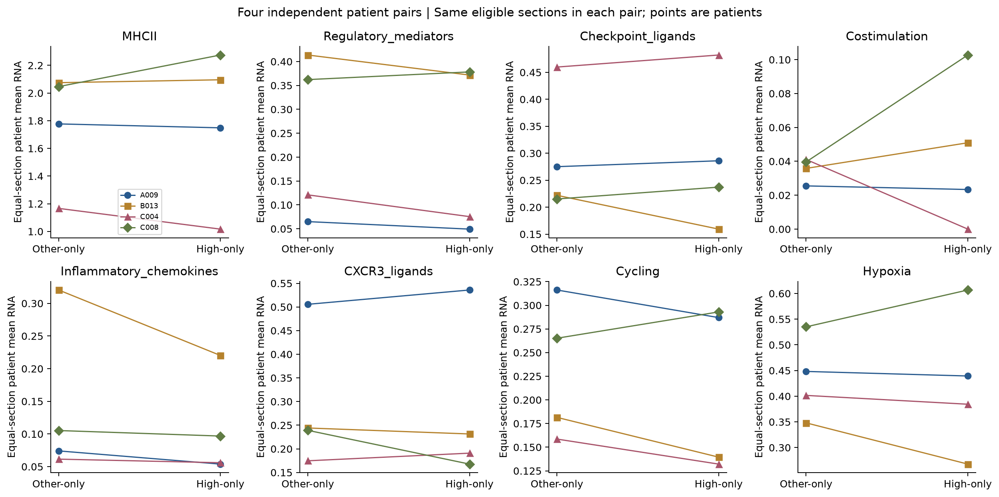
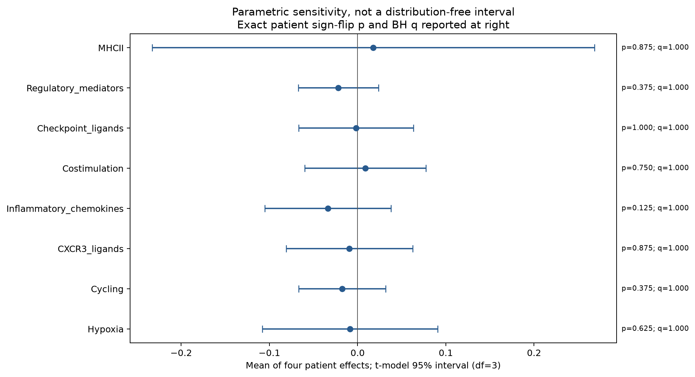
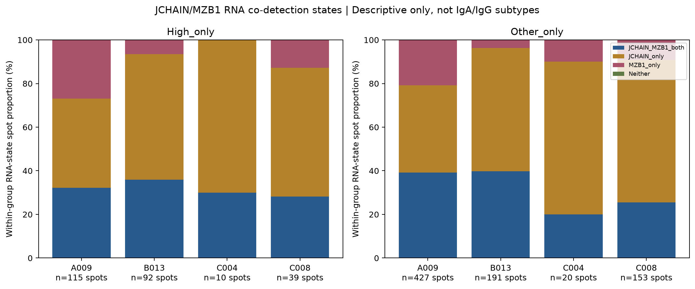

# GSE281759：以4位患者为独立单位的PGAM5-high邻域浆细胞相关RNA功能分析

**严格按患者作为比较单位：A009、B013、C004、C008分别贡献1个配对效应，统计样本量n=4。** 切片、浆细胞相关位点及空间边只用于构建每位患者的表达概况，不作为独立病例。患者间个体差异按4个效应展示，不用位点或切片重复对每两位患者制造显著性。

**主要结果：炎症趋化因子RNA程序在4例均偏低，但精确配对p=0.125、主8项BH q=1.0；所有主功能程序均未通过多重校正。** 现有证据不能确认邻近PGAM5-high巨噬细胞的浆细胞具有独特分泌、免疫抑制或抗原呈递功能。这里仍是混合Visium位点的RNA关联，不是已证实的单细胞互作或功能实验。

## 患者内分组，再汇总为4个独立配对

保留前轮固定巨噬RNA门、PGAM5检出源Q75高表达门及浆细胞RNA门。真实六边格第一圈、无自环用于邻接。

- **High-only目标**：浆细胞相关RNA位点至少有一个PGAM5-high巨噬相关来源邻居，且没有其他PGAM5检出巨噬来源邻居。
- **Other-only对照**：至少有一个其他PGAM5检出巨噬来源邻居，且没有high来源邻居。
- 同时邻接两组的目标单列Shared，不纳入主互斥比较；两种检出源均未邻接者单列，不称为没有巨噬细胞。

每片两组都至少3个目标位点才纳入该患者配对汇总。这个较低阈值是为保留4例的探索性描述而设，并不使稀疏目标成为可靠的单细胞群。**同一患者高组和对照使用完全相同的合格切片**：先逐片计算各组平均功能RNA分数，再对该患者合格切片等权求均值；差值为high均值减other均值。不同患者在统计中等权。没有将全部位点直接合并为病例比较，也没有让位点多的切片按位点数量加权主导患者效应。

| 患者 | 主比较合格切片 | high-only目标数（描述） | other-only目标数（描述） | 合格切片 |
| --- | ---: | ---: | ---: | --- |
| A009 | 3 | 111 | 416 | A009T1、T4、T5 |
| B013 | 4 | 90 | 189 | B0013T2、T3、T4、B013T5 |
| C004 | 2 | 10 | 20 | C004T1P、T1R |
| C008 | 2 | 38 | 152 | C008T1、T2 |

这些目标数是合格切片内去重计数，不是统计n；图中“全部切片支持数”另外包含不满足主比较阈值的切片，因此可能不同。主分析共11张合格切片，始终只有4位独立患者。

## 患者之间的功能效应差异

表内为每位患者的配对均值差，单位为多基因平均log1p(CP10k)，正值表示high邻域更高。不是log2 fold change、Cohen d、蛋白活性或细胞分泌量。

| RNA程序 | A009 | B013 | C004 | C008 | 精确配对p | 主BH q |
| --- | ---: | ---: | ---: | ---: | ---: | ---: |
| MHC-II抗原呈递 | −0.028 | +0.021 | −0.150 | +0.228 | 0.875 | 1.0 |
| IL10/TGFB1/LGALS9调节因子 | −0.016 | −0.042 | −0.046 | +0.016 | 0.375 | 1.0 |
| 检查点配体 | +0.011 | −0.063 | +0.022 | +0.022 | 1.000 | 1.0 |
| 共刺激配体 | −0.002 | +0.015 | −0.041 | +0.063 | 0.750 | 1.0 |
| 炎症趋化因子 | −0.020 | −0.100 | −0.005 | −0.008 | 0.125 | 1.0 |
| CXCR3配体 | +0.030 | −0.013 | +0.016 | −0.071 | 0.875 | 1.0 |
| 增殖 | −0.029 | −0.042 | −0.026 | +0.028 | 0.375 | 1.0 |
| 缺氧 | −0.009 | −0.080 | −0.017 | +0.072 | 0.625 | 1.0 |

炎症趋化因子（CCL2/CCL3/CCL4/CCL8/CXCL8）是主原始比较中唯一4例均负的程序，调整混合RNA与测序质量后仍为4例均负。但效应幅度差异明显，不能称为已经证实的功能下调。MHC-II、检查点、共刺激等方向不统一；免疫调节因子也不是一致的免疫抑制或激活证据。





## 统计方法：患者为唯一推断单位

主检验对4个患者配对差值进行双侧精确符号翻转：枚举2⁴=16种符号组合，比较平均效应绝对值。这依赖患者独立及零假设下差值近似符号对称/可交换，不是随机治疗试验。**n=4时最小双侧p为2/16=0.125**，不能达到0.05；不把这一限制解释为真实生物学没有差异。报告效应方向、个体幅度与患者间异质性更有意义。

另给出以4个患者高/对照均值作配对t检验（等价于对4个差值作单样本t检验）、df=3的t模型95%均值区间，作为**参数分布假设敏感性**，不是主分布无关证据。4例不足以可靠验证差值正态性；区间和p均可能不稳定，没有使用“先做正态性检验再选最小p”的策略。主原始8程序配对t的最小BH q约0.909，也没有显著结果。

预设主8程序独立BH。敏感性每个“比较×原始/调整×全部肿瘤/仅原发”组合各自按8项BH，同时输出全部96项的联合精确检验BH；不将敏感性中最小p替代主结果。少于4位有可配对观察的患者时不报告推断p，缺失仅在BH家族校正时以1占位。所有敏感性家族也无BH q<0.05结果；完整值见 [patient_level_statistics.csv](patient_level_statistics.csv)。

**不能以“4位患者各为一组、每组多个位点”做ANOVA或位点级患者两两检验**：这样仍会把位点充当生物学重复。四位患者各自只有一个独立病例观察，本轮仅比较其个体功能效应并对4个配对作总体统计，不给出A009-vs-B013等病例组的伪精确显著性。

患者效应的测量误差、切片空间相关和组织采样差异仍会影响结果；等权切片汇总并不能消除这些问题，也未把位点/边自助法区间冒充病例间置信区间。

## 功能标志及浆细胞RNA状态的限制

现有每片AnnData是选择marker子集，并非全基因矩阵。主功能分析仅使用16片均有覆盖的8套固定程序：

| 程序 | 基因 |
| --- | --- |
| MHC-II | HLA-DRA、HLA-DRB1、HLA-DPA1、HLA-DPB1、CD74 |
| 调节因子 | IL10、TGFB1、LGALS9 |
| 检查点配体 | CD274、PDCD1LG2、PVR、NECTIN2 |
| 共刺激 | CD80、CD86、ICOSLG、TNFSF9、TNFSF4 |
| 炎症趋化 | CCL2、CCL3、CCL4、CCL8、CXCL8 |
| CXCR3配体 | CXCL9、CXCL10、CXCL11 |
| 增殖 | MKI67、TOP2A、UBE2C、CENPF、BIRC5、PCNA |
| 缺氧 | CA9、VEGFA、SLC2A1、LDHA、BNIP3、ADM |

分数为各程序基因log1p(CP10k)算术均值，包括零值，归一化分母来自原始全36,601个feature库大小，不按marker子集重算。它们是功能相关RNA代理，不是完整GO/KEGG通路富集。MHC-II、趋化、检查点及缺氧标志均可能来自混合B/T、髓系、上皮或其他细胞，不能归属为浆细胞的功能。

PRDM1/XBP1/IRF4、完整分泌/UPR装置、IgA/IgG恒定基因和CXCR4等标志缺失或各片覆盖不一致，见 [functional_marker_coverage.csv](functional_marker_coverage.csv)。未把不在输入文件中的基因填0，也未根据某片额外marker推断其他患者的抗体类型。**本轮无法可靠划分IgA型/IgG型、成熟/未成熟、抗体分泌型或IL10分泌型浆细胞亚群。**

作为透明的亚群相关描述，另将原浆细胞RNA门中的目标分成JCHAIN/MZB1均检出、仅JCHAIN、仅MZB1及均未检出的RNA状态。它们只代表所选标志的共检出状态，受掉落影响，不是已经分辨的纯浆细胞亚群或分化轨迹。状态构成图按位点描述，未将其比例当作患者统计重复。



## 敏感性分析

1. **任何high邻接vs无high邻接**：包括Shared目标，检验对照定义对患者效应的影响。
2. **MZB1且JCHAIN共同检出**：在原浆细胞RNA门内追加两标志共检出后重新求互斥邻接组、逐片均值及患者效应；不重新定义来源high门。全部肿瘤分析可形成4例配对，原发-only严格分析仅3例可配对，因此不报告4患者推断p。
3. **调整后RNA**：逐片在全部固定浆细胞相关目标上拟合不含邻接组标签的协变量模型，调整logUMI、MT%、浆细胞身份、巨噬、T、B、上皮及肝细胞RNA代理、3×3空间区块；使用平均残差差，再按同样的患者等权切片规则汇总。至少剩余15自由度才估计。RNA代理不是反卷积细胞比例，模型调整不能纯化细胞，亦可能移除真实生物学信号。
4. **仅原发切片**：排除C004T1R复发切片，C004仍是同一个患者，不作为两个病例。

主分析包含C004原发和复发两个时间/组织状态，等权汇总只保证患者不被重复计数，不能消除状态差异；原发-only结果用于检查这一点。缺少TLS或其他病理ROI，未将所有位点称为恶性组织。

## 可视化与输出

- [四患者配对表达图](figures/four_patient_paired_profiles.png)
- [原始/调整后的患者效应热图](figures/patient_raw_adjusted_effect_heatmaps.png)
- [患者效应区间和精确检验](figures/patient_effect_intervals_and_exact_tests.png)
- [JCHAIN/MZB1 RNA状态构成](figures/patient_RNA_state_composition.png)
- [患者目标数量支持](figures/patient_target_support.png)
- 真实H&E叠加：[A009](figures/A009_plasma_target_spatial_maps.png)、[B013](figures/B013_plasma_target_spatial_maps.png)、[C004](figures/C004_plasma_target_spatial_maps.png)、[C008](figures/C008_plasma_target_spatial_maps.png)

共9套PNG/PDF。原始和调整热图各自有独立标注色标；配对图每条线/点对应一位患者，不能将同一患者跨程序重复显示的点再次计为病例。RNA状态比例和支持数量是描述性位点计数。空间图位置来自真实图像比例及像素坐标，未使用UMAP邻接；粉色圈为high巨噬相关源，目标颜色代表RNA邻接组。

核心表：[patient_paired_effects.csv](patient_paired_effects.csv)（一行一个患者效应）、[patient_level_statistics.csv](patient_level_statistics.csv)（患者层面推断）、[section_effects_descriptive.csv](section_effects_descriptive.csv)（构造效应的切片描述，无位点/切片显著性p）、[RNA_state_counts.csv](RNA_state_counts.csv)。

## 来源与复现

官方：[GSE281759](https://www.ncbi.nlm.nih.gov/geo/query/acc.cgi?acc=GSE281759)，PMID41950768。本轮输入来自同仓库[前轮空间表达](../GSE281759_spatial_HCC_PGAM5/README.md)及[免疫RNA邻域注释](../GSE281759_PGAM5_immune_subgroup_neighbors/README.md)，源提交`4f8bc34d2a1a9173324d16f1893f453ee480dbea`。原QC为in_tissue、UMI≥500、基因≥200、MT≤25%，不同于论文MT≤5%，本轮没有重做MT5全患者分析。

A009N非肿瘤切片排除；B0013T1–T4/B013T5统一患者B013；C004T1P/R属同一患者。全基因原始矩阵不在当前GSE281759工作区，环境NCBI访问此前被策略拒绝，未将GSE245908全矩阵替代本数据。没有CellChat/LIANA通信显著性或PGAM5虚拟敲除推断。

输入包保存16个含图像、图结构、原计数和全库归一化值的marker AnnData，所有图表/代码/审核均打包。首次从前轮数据构造输入需要同仓库目录；已有本轮输入时可独立重算，无需读取前轮目录。SHA清单：[input_manifest.json](input_manifest.json)。不能按子集库大小重新归一化，也不能用其做全基因组富集。

**2,214项核查通过**：[audit_results.json](audit_results.json)。包括输入SHA、全库归一化、KD-tree真实邻接、目标分组计数与严格状态、程序分数、独立OLS残差、全部患者等权聚合、16种患者符号翻转、配对t重算及BH。审核复用了协变量构造，不能视作外部模型选择验证；人工检查配对图及效应区间图。没有声称本轮重新取得全部原始矩阵或完成单细胞/蛋白验证。

```bash
python -m venv .venv
. .venv/bin/activate
pip install -r requirements.txt
OPENBLAS_NUM_THREADS=1 python analyze.py
OPENBLAS_NUM_THREADS=1 python plot.py
OPENBLAS_NUM_THREADS=1 python audit.py
python package_results.py
```

全部结果汇总包：[GSE281759_PGAM5_plasma_patient4_all_results.zip](GSE281759_PGAM5_plasma_patient4_all_results.zip)。
