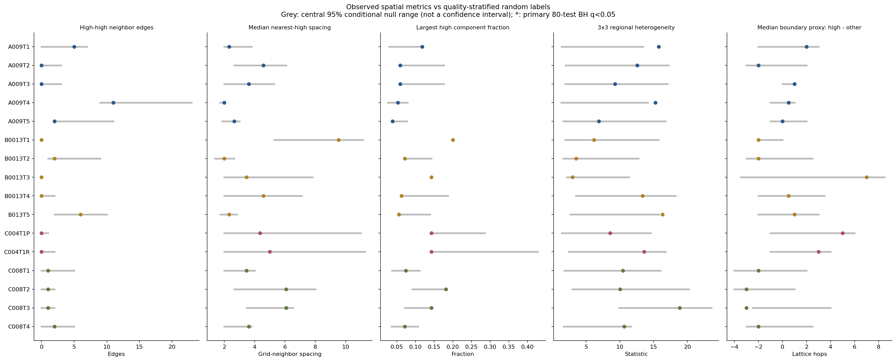

# GSE281759：PGAM5-high 巨噬 RNA 位点的空间分布

**在第一圈邻接层面以孤立位点为主，仅存在少量2–4位点小簇；相对于其他PGAM5检出巨噬RNA位置及检测质量，没有发现多重校正后显著的额外聚集、区域不均匀或边界代理偏移。**这是空间RNA位点分布，不是单细胞巨噬细胞定位；PGAM5可来自位点内其他混合细胞。

## 范围与总体特征

4位HCC患者、16张肿瘤切片（15原发、1复发），25,354个QC位点、4,091个巨噬RNA富集位点；固定PGAM5-high源382个。A009N排除，B0013/B013统一为B013，C004原发/复发是同一患者。无病理恶性ROI分割。

沿用主QC（in_tissue=1、UMI≥500、基因≥200、MT≤25%）、巨噬核心与Pan-myeloid门、门内PGAM5检出源Q75高表达规则，保留并列。原论文MT≤5%，本轮未重做该阈值完整敏感性。高表达阈值在各切片独立确定，不能把病例高组比例直接当作绝对表达差或细胞浸润比例。

- 325/382（85.1%）没有另一high位点的第一圈邻居；57/382（14.9%）有至少一个。
- high–high共31条无向第一圈边；连通组件为325个单点、23个两点、1个三点、2个四点。最大簇4个位点，出现在A009T1和A009T4。
- “孤立”仅指没有第一圈high邻居，不代表远离其他免疫细胞，也不排除较大尺度模式；各high位点均有其他QC位点邻居。
- 逐切片最近high距离的中位数为2.00–9.54个“相邻Visium位点间距”单位。不是实测微米，受high数量及可用组织范围影响，不能仅据原始距离认定聚集。

## 患者描述

| 患者 | 切片 | high位点 | high占Mac-RNA% | 有high第一圈邻居% | 切片最近high距离中位数 | 切片边界代理差中位数 |
|---|---:|---:|---:|---:|---:|---:|
| A009 | 5 | 196 | 14.4 | 15.8 | 2.65 | +0.5 |
| B013 | 5 | 92 | 6.6 | 17.4 | 3.46 | +0.5 |
| C004 | 2 | 14 | 6.3 | 0.0 | 4.68 | +4.0 |
| C008 | 4 | 80 | 7.1 | 12.5 | 4.84 | −2.5 |

距离单位为网格相邻间距；边界差单位为格邻接步数，正值表示high相对其他检出源更靠内，负值更靠代理边界。上述为患者描述与同患者切片等权中位数，**没有将切片或位点作为独立患者进行总体t/Wilcoxon检验**。C004只有14个high，统计能力有限。数量/比例还受组织大小、测序检出和相对Q75门影响。

## 指标和边界限制

采用真实Visium阵列坐标及六边形第一圈连接，无自环。距离坐标为`x=array_col/2`、`y=sqrt(3)*array_row/2`，相邻位置距离为1。H&E图使用真实像素坐标和原缩放，不使用UMAP。

预设五个切片指标：

1. high–high无向边数：更大支持第一圈聚集。
2. 最近high距离中位数：更小支持几何聚集。
3. 最大high连通组件占high比例：更大支持连通聚集。
4. 固定3×3全QC阵列粗箱的high/其他检出源不均匀统计量：等价于2×有效箱列联的Pearson统计量，但用条件置换检验，不采用独立位点卡方近似p。不对应病理ROI。
5. high与其他检出源到边界代理的距离中位数差：双侧检验。

**边界是QC前矩阵中可用in_tissue条形码坐标的掩膜边界**，以缺少六方向邻居的位置为边界、格图最短路径步数作距离。它受矩阵可用性、切片裁切及缺失位点影响，并非完整组织学轮廓，尤其不是肿瘤浸润边缘、包膜、血管或TLS边缘。C008的负向差只能作几何描述，不能据此认定侵袭边缘富集。

粗箱的高比例可能因分母很小，例如4/4；高比例箱不等于第一圈连通簇，也不等于显著热点。每箱high/检出Mac-RNA分子分母均保留到`spatial_bin_counts.csv`，未将比率当作物理面积密度。

## 随机标签检验

候选位置为固定巨噬RNA门内全部PGAM5检出位点：382个high及1,123个其他检出源，共1,505个。本轮位置分布分析保留一个无QC格邻接的其他检出源，故较之前免疫邻域报告的1,122个对照多一个；阈值及high数量不变。这样将high放在真实可检出的巨噬RNA候选位置上随机化，而非与全组织均匀随机点比较，减少把巨噬RNA自身聚集误当high特有聚集。

每片4,999次随机标签：主模型按候选源全局UMI二分位×巨噬核心二分位分层，保留层内high数；敏感性进一步加入全片3×3空间粗箱，以检验超出粗区域结构的局部特征。前三聚集指标和区域不均匀使用预设单侧方向，边界差用双侧等尾+1校正，条件零分布不假定以0为中心。聚集检验不等同于所有尺度的完整空间模式检验。

预设5×16=80项主BH；两种零模型联合160项BH；排除复发另75项主BH。high<5、对照<10或条件零分布恒定不可检验，p缺失，校正时临时计1。主80项76可检验、4不可检验；敏感性80项53可检验、27不可检验。敏感性固定每个粗箱high数，区域不均匀指标按设计恒定，不能据其不可检验断言无区域差异。

**主最小q=.420，联合160项最小q=.840，原发限定75项最小q=.39375；全部没有q<.05。**主模型名义结果包括A009T1/T4、B013T5、C008T4的区域不均匀（p=.009/.0166/.021/.0408）及C008T3负向边界差（p=.014），均未通过BH，不能升级为稳定热点或病理边缘定位。

随机标签依赖层内可交换性，粗质量分层不能完全消除RNA混合、微观质量梯度或未观测结构。患者才是独立生物学单位，不合并各片p值作为4病例总体推断。未显著不证明不存在生物学分布规律。

此前全QC位点PGAM5连续表达的Moran统计与本轮固定high巨噬RNA点位随机标签检验不同，不能直接借前者推断本轮聚集。

## 可视化和下载



- [逐切片数量与比例](figures/section_high_distribution_summary.png)、[连通组件大小](figures/high_component_size_distribution.png)、[主FDR](figures/spatial_distribution_FDR.png)。
- H&E真实位置、连通簇与粗箱比例：[A009](figures/A009_high_distribution_spatial_maps.png)、[B013](figures/B013_high_distribution_spatial_maps.png)、[C004](figures/C004_high_distribution_spatial_maps.png)、[C008](figures/C008_high_distribution_spatial_maps.png)。

共8组PNG/PDF。点是实际位点，粗箱文字为high/全部检出Mac-RNA；灰色零分布中间95%范围是随机标签参考，**不是效应置信区间**。没有定义病理ROI或局部显著热点。

## 来源与复现

GEO：[GSE281759](https://www.ncbi.nlm.nih.gov/geo/query/acc.cgi?acc=GSE281759)。复用此前已经与用户上传原始计数及来源SHA核验的空间对象，未重下载或改变源门。源仓库提交`44783c4bf35a9a0743984448baf3e8c72b5bb136`；32个对象/QC表SHA见`reference_manifest.json`。逐位点分布注释、组件、区域分母、患者汇总、全部置换零分布和代码入包；基础对象及图像从同仓库读取。

16项无自环对称图检查通过；另1,762项独立SHA、源门、KD-tree格图/最近距离、Dijkstra边界代理、DFS组件、置换分层计数、前三次零指标重建、p及BH核验全部通过。结果见`audit_results.json`与`independent_audit_results.json`。人工查看空间图与条件零分布图，程序核验不替代细胞来源或组织学确认。

```bash
git clone https://github.com/183285068-droid/codex.git
cd codex
python -m venv /tmp/gse281759_distribution_env
. /tmp/gse281759_distribution_env/bin/activate
pip install -r results/GSE281759_PGAM5_spatial_distribution/requirements.txt
OPENBLAS_NUM_THREADS=1 python results/GSE281759_PGAM5_spatial_distribution/analyze.py
OPENBLAS_NUM_THREADS=1 python results/GSE281759_PGAM5_spatial_distribution/plot.py
OPENBLAS_NUM_THREADS=1 python results/GSE281759_PGAM5_spatial_distribution/audit.py
python results/GSE281759_PGAM5_spatial_distribution/package_results.py
```
