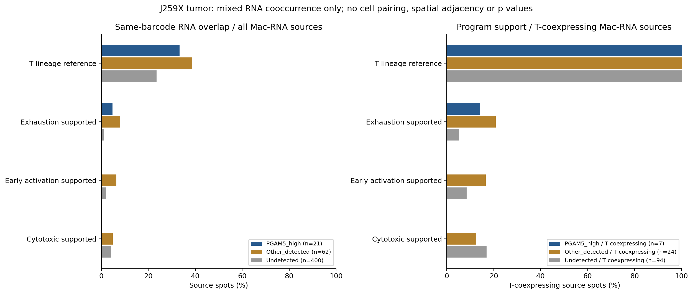

# GSE283406肿瘤病例：PGAM5-high巨噬RNA的T细胞表达候选

**完成可用数据的T谱系、耗竭支持、早期活化及细胞毒程序表达分析和可视化，但真实空间互作亚群识别仍未完成：缺少barcode组织坐标。**当前证据仅是同位点混合RNA共现及配体/受体分别检出，不能确认为邻近T细胞、通讯或功能作用。

## 病例与主范围

GSE283406只有1位匿名HCC患者。J259X为肿瘤切片，本轮仅分析其AVITI数据（GSM8661792）；J259B含肿瘤和邻近组织，不纳入肿瘤主分析。NextSeq与AVITI为技术测序，4个GSM不是4位患者，不进行患者比较或将位点作为病例重复的p值检验。

3,922个QC位点、483个巨噬RNA富集位点，其中PGAM5-high21个、其他检出62个、未检出400个。Visium FFPE完整探针面板18,085特征，复用UMI≥500、检出基因≥200规则；没有套用poly(A)的MT25%规则。输入仅是便携marker子集，归一化分母仍为完整面板全库UMI，未对子集重新归一化。

源门C1QA/B/C、CD68、CSF1R、MERTK、MSR1平均≥全片Q75、≥3核心标志且Pan-myeloid≥中位数。high为门内PGAM5原始计数>0、log1p(CP10k)≥检出源Q75，保留并列；阈值1.096751。混合位点的PGAM5不能确定来自巨噬细胞。

## T程序与主要结果

固定T门为CD3D/E/G、TRAC、TRBC1/2平均≥全片Q75且≥2标志；三种状态都限定T门，均值≥T门Q75、>0、≥2程序基因：

- 耗竭支持：PDCD1、LAG3、TIGIT、CTLA4、TOX、CXCL13。
- 早期活化支持：CD69、IL2RA、TNFRSF9、ICOS、CD40LG、IL2。
- 细胞毒支持：IFNG、PRF1、GZMB、GZMA、CCL5、TBX21。

均值包括零值，保持旧门定义，未根据本轮结果降阈值。状态可重叠；细胞毒支持不等于确认CD8身份，RNA程序不证明耗竭功能或激活作用。

| RNA门 | 肿瘤全切片目标 | high同barcode共现 | 其他检出同barcode共现 |
|---|---:|---:|---:|
| T谱系参考 | 575 | 7/21（33.3%） | 24/62（38.7%） |
| 耗竭支持 | 37 | 1/21（4.8%） | 5/62（8.1%） |
| 早期活化支持 | 36 | 0/21（0.0%） | 4/62（6.5%） |
| 细胞毒支持 | 73 | 0/21（0.0%） | 3/62（4.8%） |

**这些数值是同一个barcode同时满足巨噬源和T门，不是两个细胞或两个相邻位点。**没有构建边、配对、通讯概率或互作分数。未检出共现不证明相应T细胞或远处相互作用不存在。

在同时满足T门的巨噬源内，high只有7个位点，耗竭支持1/7（14.3%）；其他检出24个位点，耗竭5/24（20.8%）、早期活化4/24（16.7%）、细胞毒3/24（12.5%）。描述性比例不支持把耗竭RNA称为high特有增强，更不能解释为PGAM5促耗竭。样本量和混合RNA归属不支持病例层面统计，未报告显著性或因果。

575个T父门位点分成8种互斥的三程序组合：仅活化24、活化+细胞毒5、仅细胞毒58、仅耗竭21、耗竭+活化6、三者同时1、耗竭+细胞毒9、未满足任何状态451。7个high/T共现位点中仅耗竭1、未满足三状态6。后者不标为初始/记忆或静息细胞。

## 配体/受体表达线索

用保存的LIANA1.10.0资源核验五对定义：SPP1–CD44、PVR–TIGIT、NECTIN2–TIGIT、LGALS9–HAVCR2、CD274–PDCD1。仅分开统计巨噬源配体和T RNA门受体，不进行source→target配对。

high源配体检出为SPP1 13/21、NECTIN2 11/21、PVR 2/21、LGALS9 1/21、CD274 1/21。575个T门内CD44检出194/575；37个耗竭支持位点中TIGIT17/37、PDCD1 14/37。各目标门有重叠，也可与源在同barcode共现，因此“分别汇总”不代表统计独立样本。

受体与耗竭门共用标志，不能将检出作为独立耗竭验证；混合位点的受体不一定来自T细胞。未运行CellChat/LIANA显著性算法，未证明蛋白结合、空间邻接或PGAM5机制。

## 仍缺的数据和本轮核查

本轮检查作者仓库remote HEAD仍为`e9fcbdca77c9f0fad02618bbe54ca4e3591dbd5c`，与此前公开源码快照一致，未执行作者脚本。此前该树的10文件没有barcode坐标或完整空间对象，作者脚本依赖未公开的本地outs目录。当前工作区及既有表达预分析ZIP中没有原始全矩阵、坐标或缩放附件。本轮NCBI feature请求为CONNECT 403，没有声称重新下载GEO附件；访问记录见`source_access_check.json`。

保存的GEO附件清单只列矩阵、features、barcodes与图像，没有列坐标和scalefactors；该清单不是本轮在线刷新。组织图像或表达UMAP不能代替barcode映射，未从图像、barcode排序或表达距离猜坐标。

当前marker子集缺少可靠CD8/CD4、Treg、初始/记忆程序所需的完整标志组合，见`marker_coverage.csv`；这不表示这些基因一定不在原始FFPE面板，也不表示细胞不存在。此前确认FCN1及部分HLA-II不在完整面板的结论不能泛化给其他未核查基因。因此不能将GSE281759的CD8/记忆/Treg分类直接移植给当前输入。

继续真实空间分析需要J259X：

1. `tissue_positions.csv`或`tissue_positions_list.csv`，以及`scalefactors_json.json`，或包含真实barcode空间映射的完整Seurat/AnnData对象。
2. `GSM8661792_J259X.matrix.mtx.gz`、`.features.tsv.gz`、`.barcodes.tsv.gz`，以核查全探针标志及补充T亚群；完整矩阵并不保证FFPE面板覆盖所有需要的基因。

若以后加入J259B肿瘤点分析，还需逐barcode TumorLabel或可配准的病理ROI。缺少上述信息，用户请求中的真实空间互作对象识别不能完成；本轮没有用表达共现替代该结论。

## 图表与复现



- [状态组合](figures/T_state_combinations.png)。
- [配体和受体分别表达](figures/T_ligand_receptor_independent_expression.png)。
- [表达UMAP](figures/T_expression_UMAP_not_spatial.png)：不是组织图，未画互作边。
- [定义标志证据](figures/T_marker_evidence.png)：不是独立身份验证。

共5组PNG/PDF。本包包含肿瘤marker输入、资源快照、逐位点注释、计数、配置、审核及代码，可以离线复算。源仓库提交`8ef41f14e8bed8aa723105793429a746f60be8e6`，输入来自此前表达预分析，SHA见`reference_manifest.json`。官方[GSE283406](https://www.ncbi.nlm.nih.gov/geo/query/acc.cgi?acc=GSE283406)，论文DOI[10.3389/fcell.2025.1600129](https://doi.org/10.3389/fcell.2025.1600129)。

100项输入SHA、全库归一化、high Q75、独立T门重建、同barcode/条件分母、配体/受体分别计数、资源和组合分区审核通过；无空间结构被伪造。结果见`audit_results.json`，人工查看主要图表。全矩阵不在本地，未声称本轮完成其原始独立复核。

```bash
python -m venv .venv
. .venv/bin/activate
pip install -r requirements.txt
OPENBLAS_NUM_THREADS=1 python analyze.py
OPENBLAS_NUM_THREADS=1 python plot.py
OPENBLAS_NUM_THREADS=1 python audit.py
python package_results.py
```


## 新上传文件核对（2026-10-12）
两份 Series Matrix 表达数据表为空；SOFT/XML 列出 4 个样本共 20 个矩阵、基因表、条形码和图片附件，未列出 tissue_positions 或 scalefactors。新上传 RAW 包超过 32 MiB 执行环境传入上限，尚未检查包内内容。该批上传未消除空间坐标缺口，不能据此宣布空间互作分析完成。附件清单见 uploaded_metadata_check.json。
