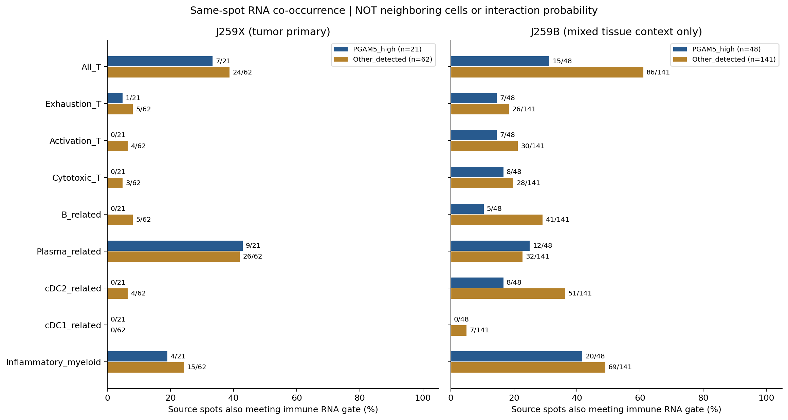
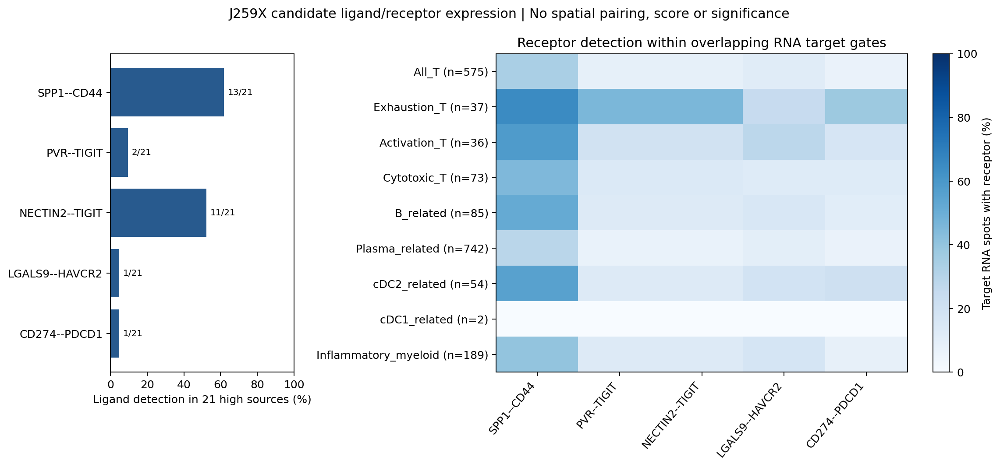

# GSE283406肿瘤病例：PGAM5-high巨噬相关RNA的免疫候选表达线索

**目前不能确认与PGAM5-high巨噬细胞实际互作的免疫亚群，因为barcode对应组织坐标缺失。** 本轮完成公开可用表达数据的9类免疫RNA门、同位点混合RNA共现及5对候选配体/受体的独立表达概况，生成可视化并核验；没有将表达线索写成空间邻接、细胞通讯显著性或已经确认的互作对象。

## 肿瘤病例与主分析范围

GSE283406只有1位匿名HCC患者，J259X为肿瘤切片，J259B含肿瘤和邻近组织。两切片均有NextSeq/AVITI技术测序，4个GSM不等于4位患者。主分析使用J259X AVITI（GSM8661792），J259B AVITI（GSM8661791）仅作混合组织背景，不能将其全部位点认定为病理肿瘤点。

| 输入 | QC位点 | 巨噬RNA富集 | PGAM5-high | 其他检出 | 未检出 |
| --- | ---: | ---: | ---: | ---: | ---: |
| J259X，肿瘤主分析 | 3,922 | 483 | 21 | 62 | 400 |
| J259B，混合组织背景 | 2,372 | 421 | 48 | 141 | 232 |

源门为C1QA/B/C、CD68、CSF1R、MERTK、MSR1平均≥全片Q75、≥3个核心标志检出且泛髓系RNA≥中位数。PGAM5-high为该门中PGAM5原始计数>0、归一化表达≥检出源Q75（并列保留）；J259X阈值1.096751、J259B阈值0.711647 log1p(CP10k)。逐片分位门不能当作跨切片统一蛋白阈值，也不能确认PGAM5来源于巨噬细胞。

## 可评估的免疫RNA类别与共现

下表“high同位点共现”是在**同一barcode**同时满足两种RNA门，分母21个high源。它不是邻近目标数、细胞浸润量、细胞互作概率或两个细胞的数量，标签可重叠、不能相加。

| J259X RNA候选类别 | 全切片该类RNA位点 | high同位点共现 | 比例 |
| --- | ---: | ---: | ---: |
| 全部T谱系（基线） | 575 | 7/21 | 33.3% |
| 耗竭支持T相关 | 37 | 1/21 | 4.8% |
| 活化支持T相关 | 36 | 0/21 | 0% |
| 细胞毒T相关（无CD8身份确认） | 73 | 0/21 | 0% |
| B细胞相关 | 85 | 0/21 | 0% |
| 浆细胞相关 | 742 | 9/21 | 42.9% |
| cDC2相关 | 54 | 0/21 | 0% |
| cDC1相关 | 2 | 0/21 | 0% |
| 炎症髓系相关 | 189 | 4/21 | 19.0% |

**可优先保留浆细胞相关、T谱系和炎症髓系RNA作为后续空间验证线索。** 这仅按本轮同位点RNA观察提出候选；不能称它们是已确认的PGAM5-high巨噬细胞邻居、特异富集亚群或免疫抑制对象。cDC1极稀疏，其他类别0共现不证明对应细胞或远处相互作用不存在。

与其他PGAM5检出巨噬相关源相比，浆细胞RNA共现为9/21（42.9%）vs26/62（41.9%），T谱系为7/21（33.3%）vs24/62（38.7%），炎症髓系为4/21（19.0%）vs15/62（24.2%）。这些描述性比率不支持把浆细胞RNA说成high源特有信号；没有进行位点级显著性检验替代单个病例的生物学重复。



T门及耗竭、活化、细胞毒状态保持前轮定义：T谱系≥Q75、≥2标志检出；状态在T门内≥Q75、>0、≥2程序标志。B、浆细胞、cDC2、cDC1及髓系门为固定多基因均值≥全片Q75、>0并≥2标志检出（浆细胞≥3），再要求相应锚定标志。cDC1要求CLEC9A和XCR1同时检出，炎症髓系要求VCAN检出及泛髓系≥中位数。完整基因与规则见[analysis_config.json](analysis_config.json)、[analyze.py](analyze.py)。没有基于结果调低门限或伪造缺失基因。

NK、Treg、初始/记忆T、CD4/CD8身份、pDC、粒细胞及肥大细胞的关键标志不在当前marker输入中，本轮不能完整注释这些亚群。FCN1和4个HLA-II标志在前轮18,085特征探针面板核查中已确认缺失，因此炎症髓系不能标为确定单核细胞，也不能将CD74单基因当作完整MHC-II程序。其他“不在marker输入”的基因未一概宣称缺失于原始探针面板；原始全矩阵本轮不在工作区，尚未重核所有面板覆盖。详见[marker_coverage.csv](marker_coverage.csv)。

## 候选配体/受体：表达可用性，尚无配对

从保存的LIANA 1.10.0 omni_resource中核验5对完整覆盖的候选：SPP1–CD44、PVR–TIGIT、NECTIN2–TIGIT、LGALS9–HAVCR2、CD274–PDCD1。资源记录：[candidate_LR_resource_snapshot.csv](candidate_LR_resource_snapshot.csv)。没有运行LIANA/CellChat求解器或显著性检验。

J259X high源中SPP1检出13/21、NECTIN2 11/21、PVR 2/21、LGALS9 1/21、CD274 1/21。受体在免疫RNA门内另行汇总，例如CD44检出：浆细胞相关213/742、T谱系194/575、炎症髓系76/189；耗竭支持T的TIGIT检出17/37。

**来源配体与目标受体分开统计，没有构建任何来源–目标位点对、邻接边、互作分数或概率。** 两侧存在RNA只能说明组织中表达可用，不能证明两个位点邻接或结合。CD44/TIGIT等在混合位点中的细胞归属不明，受体也可能与目标状态门共用标志；源与目标门可在同一个barcode重叠。不能据此声称SPP1或PGAM5促进耗竭或抑制浆细胞。



TGFB1受体、IL10相关复合受体、CXCL12–CXCR4等关键基因不在本轮输入中，未用残缺复合受体代替完整通路。可用性表：[candidate_LR_independent_expression.csv](candidate_LR_independent_expression.csv)。

## 本轮重新核查的空间缺口

2026-10-12重新读取作者公开仓库，HEAD仍为`e9fcbdca77c9f0fad02618bbe54ca4e3591dbd5c`，10个跟踪文件中没有barcode坐标、scalefactors、含真实空间图像坐标的RDS/h5ad或导出的J259B逐点TumorLabel。作者Seurat.R依赖其本地J259B/J259X outs目录；这些目录不在公开仓库。本轮仅阅读作者脚本，未执行。核查清单及源码快照：[provenance/author_repository_check.json](provenance/author_repository_check.json)。

此前已获取并校验全部20个GEO附件，官方[filelist](provenance/filelist.txt)仅列表达矩阵、feature、barcode和图像，未列坐标与比例因子。本轮使用保存的GEO资料，没有声称重新在线下载或核验当前GEO所有附件。原始图像即使可查看，没有barcode映射仍不能叠加真实表达。

**因此，用户请求中的真实空间互作亚群识别仍未完成**。需要补充J259X/J259B的tissue_positions.csv（或旧版tissue_positions_list.csv）、scalefactors_json.json；若将J259B纳入肿瘤点分析，还需逐barcode TumorLabel或可配准病理ROI。也可用包含上述信息的完整Seurat/AnnData对象。

不能从barcode排序、UMAP、表达相似性或组织图像外观恢复真实组织邻接；UMAP图未画互作边，也未把距离当作空间相邻。单个病例及技术重复无法支持患者层面的显著性，本轮没有位点级p值冒充病例检验。

## 可视化与结果文件

- [同位点免疫RNA共现](figures/same_spot_immune_RNA_overlap.png)
- [肿瘤切片候选配体/受体独立表达](figures/candidate_LR_independent_expression.png)
- [J259X表达UMAP](figures/J259X_immune_expression_UMAP.png)（不是组织空间图）
- [J259B表达UMAP](figures/J259B_immune_expression_UMAP.png)（混合组织背景）
- [J259X门控标志证据](figures/J259X_marker_gate_evidence.png)

5套PNG/PDF。门控dotplot仅记录定义该门的基因，点面积为检出率、颜色为包含零值的平均表达；不能将用于定义门的标志再次当成独立身份验证。配体/受体图灰色表示无可用目标，而非受体确实为0。

核心表：[section_summary.csv](section_summary.csv)、[same_spot_RNA_overlap.csv](same_spot_RNA_overlap.csv)、[candidate_LR_independent_expression.csv](candidate_LR_independent_expression.csv)、逐片`*_immune_candidate_annotations.csv.gz`。

## 来源、质控和离线复现

官方：[GSE283406](https://www.ncbi.nlm.nih.gov/geo/query/acc.cgi?acc=GSE283406)。论文Yu et al., DOI[10.3389/fcell.2025.1600129](https://doi.org/10.3389/fcell.2025.1600129)，PMID40530332。输入及QC来自同仓库[表达预分析](../GSE283406_HCC_expression_preanalysis/README.md)，源提交`cda736d1509837c2ce93c4fdf124d020dadec65b`。10x Visium FFPE面板18,085特征，主QC UMI≥500、基因≥200；MT探针比例仅报告，未套用poly(A)的25%规则。

输入保留原始marker计数及来自全部18,085特征的CP10k/log1p值，未重新按marker子集归一化。完整结果包包含两张表达marker AnnData、所有图表、代码、审核和来源清单，不含缺失的组织坐标或全基因原始矩阵。SHA见[input_manifest.json](input_manifest.json)。

独立审核结果见[audit_results.json](audit_results.json)：输入SHA、全库归一化、PGAM5计数/Q75定义、全部程序与检出率、同位点分母、配体/受体独立计数和数据库记录，以及没有生成伪空间结构。人工检查核心图的读数与标签。没有声称重新核对不在当前工作区的所有原始矩阵。

```bash
python -m venv .venv
. .venv/bin/activate
pip install -r requirements.txt
OPENBLAS_NUM_THREADS=1 python analyze.py
OPENBLAS_NUM_THREADS=1 python plot.py
OPENBLAS_NUM_THREADS=1 python audit.py
python package_results.py
```

已包含本轮输入时可离线重算表达结果；首次复制输入需要同仓库前轮目录。整个病例只有1位患者；J259B背景和NextSeq技术比较均未扩大病例数。全部结果汇总：[GSE283406_PGAM5_immune_expression_all_results.zip](GSE283406_PGAM5_immune_expression_all_results.zip)。
