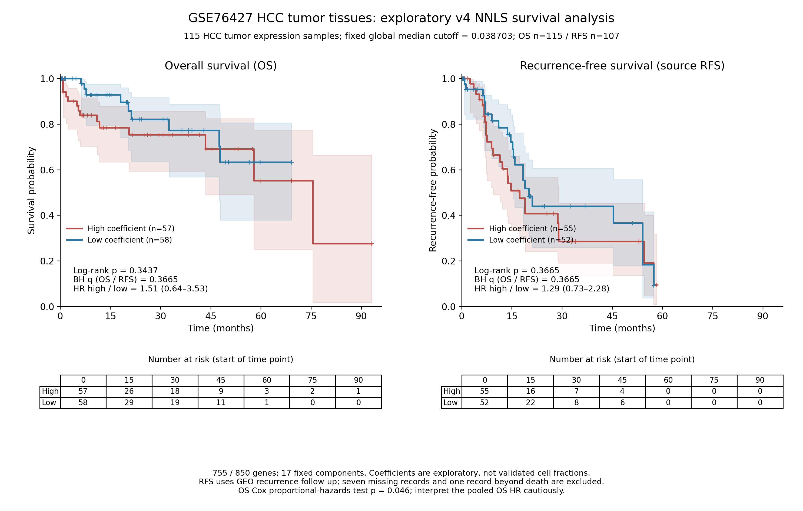

# GSE76427：固定v4探索性NNLS与OS / 源表RFS生存分析

**115份HCC肿瘤表达样本中，按预设中位数分组后，OS和RFS均未发现统计学显著的高低组差异。**
本轮使用原850基因×17组分联合参考、固定行权重和NNLS，不依据随访筛选基因或优化分组阈值。
该参考先前未通过丰度验证，结果只能视为探索性RNA参考系数与生存的关联。

## 主比较

| 终点 | 分析人数（High / Low） | 事件数（High / Low） | logrank p | BH q（两个主终点） | Cox HR，High / Low（95%CI） |
| --- | --- | --- | --- | --- | --- |
| OS | 115（57 / 58） | 23（14 / 9） | 0.343662 | 0.366546 | 1.508（0.644–3.531） |
| RFS | 107（55 / 52） | 48（26 / 22） | 0.366546 | 0.366546 | 1.291（0.730–2.282） |



主分析包含115例OS、107例RFS。OS仅23个死亡事件；后期风险人数很少，曲线尾部和中位数不宜作稳健比较。
OS二元Cox比例风险检验p=0.045967，提示恒定HR假设存在问题；该HR仅作为全程汇总模型估计，
不能解释为时间恒定的风险倍数。logrank仍按原定方法计算，未依据结局继续选择其他模型。

## 入组与原临床终点

原系列共有167份样本，来自115位患者：115份原发HCC肿瘤和52份邻近非肿瘤组织。
只在115份肿瘤样本中投影和固定阈值，不混入邻近组织。
官方GEO同一GSM记录同时提供表达、患者编号及OS/RFS信息，无需猜测患者链接。
115份肿瘤患者ID均唯一，临床元数据已与独立SOFT逐样本记录核对。

OS使用`event_os`和`duryears_os`。原论文定义为手术切除至任何原因死亡或最后随访。
RFS使用`event_rfs`和`duryears_rfs`，状态0/1按GEO原值；原论文主要研究OS，
未给出该RFS字段完整的复合事件定义，故称“源表RFS”，不把它改称DFS或PFS，也不将死亡追加为RFS事件。
两个时间字段均以年发布，分析统一乘12转为月，没有改写原随访。

OS全部115例有效。RFS有7例时间/状态缺失：HCC83、HCC16、HCC33、HCC92、HCC94、HCC35、HCC49。
HCC29记录OS死亡时间0.52年，但RFS无事件随访0.79年，超过已知死亡时间；主RFS排除该例。
因此RFS主分析107例，其中48个源表事件；排除清单保存在`endpoint_excluded_patients.csv`。
另提供保留该异常记录的108例敏感性分析，logrank p=0.344155，仍不显著。

## 表达预处理与固定投影

平台为GPL10558（Illumina HumanHT-12 v4 Expression BeadChip）。
原记录说明以GenomeStudio取得数据，用R包lumi的RSN方法归一化。
发布值是线性信号而非log2值，含背景校正负信号；**没有对芯片值做2^x指数转换**。

官方平台表有48,107个探针记录；本矩阵有47,322探针。
使用44,052个具有非空、非歧义官方Symbol的已测探针；同基因多个探针以中位数汇总，得到31,425个映射基因。
包含3个PGAM5探针：ILMN_1748027、ILMN_1788254、ILMN_1789944。
原参考在本平台覆盖755/850基因，缺失95个基因不插补、不重新筛选参考。

肿瘤矩阵有4,709个负探针值；探针汇总后有3,318个负基因值。
主分析在基因层面将负信号截为0，再对所有映射基因按每样本总和归一化到10,000。
共同755个参考基因中414个查询值受截断影响，占86,825个参考查询值的约0.48%。
以原冻结行尺度共同加权参考与查询，固定SciPy NNLS解17组分，再按系数和归一化。
目标组分为`TAM_PGAM5_detected`。

全115份肿瘤的中位数阈值为0.038703008473572192；High>中位数57例，Low≤中位数58例。
该阈值在任何OS/RFS排除之前固定；RFS最终High55例、Low52例。
共91例目标系数非零、24例为0。0是模型的边界解，不能解释为不存在目标巨噬细胞。

### 负信号敏感性

另以未经截断的原发布负信号进入同一NNLS作数学敏感性分析，归一化分母仍为所有映射基因的和。
该带负值的查询不视为物理RNA浓度，仅用于评估预处理对结论的影响。
其全115例中位数为0.039421，但与主分析相比没有任何样本改变高低分组，OS/RFS logrank值均相同。
没有根据结局选择信号处理方法。

## 补充Cox模型

连续系数按全115份表达样本标准差缩放；另做年龄与性别调整。
仅23个OS死亡事件，因此没有继续加入TNM/BCLC分期的多参数项，以限制过拟合。
所有原分期值仍保存在患者表，不对缺失分期补值。
以下补充q对2终点×4模型的8个目标系数检验统一BH，年龄/性别的辅助系数不计入该家族。

| 终点 | 模型 | 目标HR（95%CI） | 未校正p | BH q（8检验） |
| --- | --- | --- | --- | --- |
| OS | 连续系数每1 SD | 1.051（0.680–1.623） | 0.823594 | 0.823594 |
| OS | 高低组，调整年龄/性别 | 1.506（0.640–3.539） | 0.348101 | 0.748291 |
| OS | 连续每1 SD，调整年龄/性别 | 1.066（0.684–1.661） | 0.777497 | 0.823594 |
| RFS | 连续系数每1 SD | 1.093（0.823–1.452） | 0.537243 | 0.748291 |
| RFS | 高低组，调整年龄/性别 | 1.305（0.738–2.308） | 0.359200 | 0.748291 |
| RFS | 连续每1 SD，调整年龄/性别 | 1.087（0.821–1.438） | 0.561219 | 0.748291 |

各目标系数补充模型均未发现显著关联。OS调整模型中二元分组/性别的比例风险检验也有低于0.05的结果，
详见模型表；调整HR只作为探索性结果，不能据此宣称稳健的独立风险因素。

## 用途与统计限制

**这是探索性参考投影，不能解释为已经验证的PGAM5⁺巨噬细胞浸润百分比。**
加权参考秩17、条件数10.6152；加权相对拟合残差中位数0.8558，
说明参考对该bulk芯片信号的整体拟合有限。探针亲和力、背景处理及RNA-seq/芯片差异也限制细胞单位解释。
PGAM5在其他谱系也可表达，bulk关联不证明巨噬细胞特异来源或抗肿瘤功能。
OS和RFS检验不显著不是证明“没有作用”；事件数少、随访缺失和源字段异常均限制结论。

## 核验与复现

68项来源、投影和生存检查通过：独立SOFT病例/临床字段核对、逐探针官方映射、
原线性值汇总/负值处理、重建全部86,825个查询值，
24份样本独立BVLS最大系数差1.67e-15。
还独立重建完整KM乘积、各风险人数、带并列事件的logrank、Efron-Cox HR/CI/p及BH校正。
比例风险问题作为已诊断模型限制报告；数值验证不等于丰度验证。
PNG/PDF已检查；ZIP通过CRC和逐文件SHA256核验。

`inputs/GPL10558_annotation.tsv.gz`保存全部平台探针的ID、Symbol、Entrez和RefSeq字段。
为避免不必要的序列/本体字段导致结果包过大，没有放入75MB的完整SOFT；
官方全文来源、原字节数和SHA256保存在`platform_download_receipt.json`，所有计算需要的注释都包含在包内。

本目录运行：

```bash
python -m pip install -r requirements.txt
export MPLCONFIGDIR=/tmp/pgam5-matplotlib
export OPENBLAS_NUM_THREADS=4 OMP_NUM_THREADS=4
python analyze.py
python audit.py
python build_report.py
```

主要结果：`survival_statistics.csv`、`Cox_binary_continuous_age_sex_adjusted.csv`、`survival_sensitivity.csv`；
患者级数据：`patient_coefficients_clinical.csv`、`OS_analysis_patients.csv`、`RFS_analysis_patients.csv`；
审计：`input_manifest.csv`、`audit_results.json`、`endpoint_excluded_patients.csv`及`KM_*values/risk.csv`相关表。
完整包`GSE76427_v4_exploratory_NNLS_survival_results.zip`可在GitHub点击“Download raw file”。

官方来源：[GSE76427](https://www.ncbi.nlm.nih.gov/geo/query/acc.cgi?acc=GSE76427)、
[GPL10558](https://www.ncbi.nlm.nih.gov/geo/query/acc.cgi?acc=GPL10558)、
[原论文PMC5748488](https://pmc.ncbi.nlm.nih.gov/articles/PMC5748488/)。
