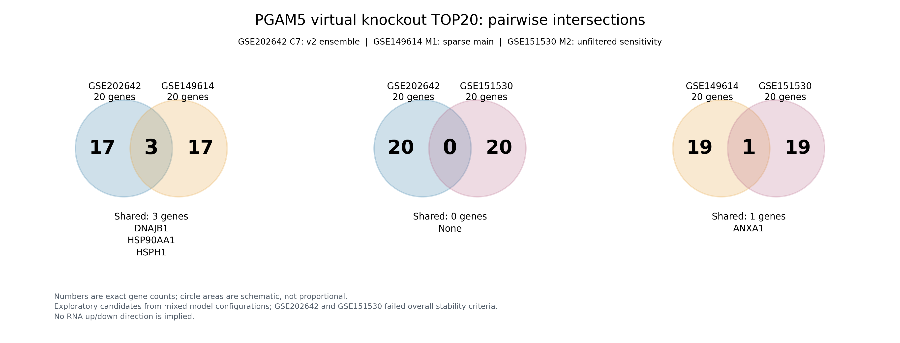
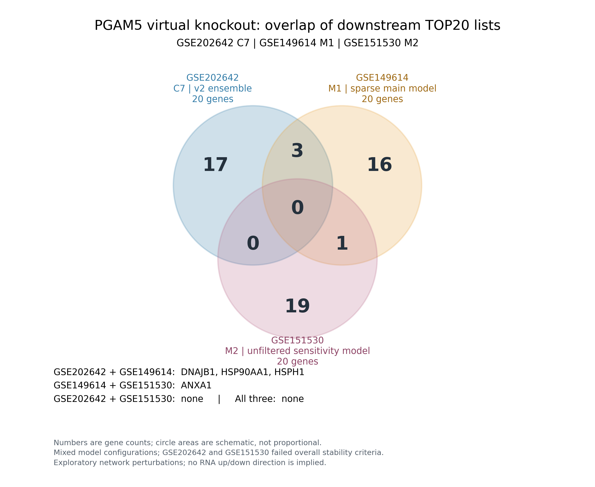
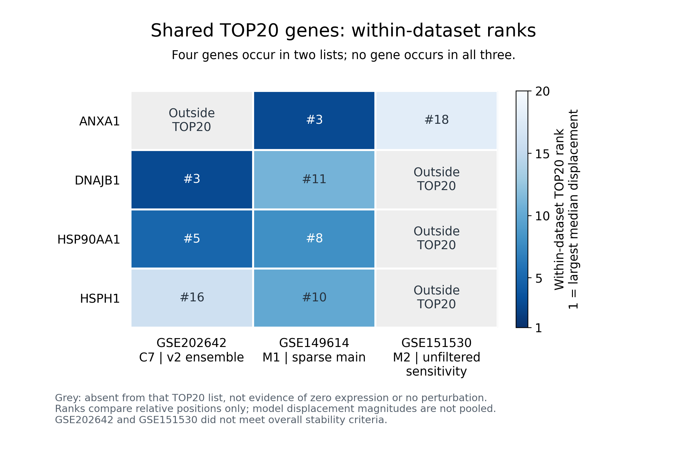

# 三个数据集PGAM5虚拟敲除TOP20交集

比较此前展示的增殖型巨噬细胞虚拟敲除下游TOP20：GSE202642旧15群版本C7（v2 ensemble）、GSE149614的M1（稀疏主模型）、GSE151530的M2（非稀疏敏感性模型）。每张表按5次运行的中位网络位移排序，共20个非靶基因；本轮未重新拟合网络。

|比较|交集数|共同基因|
|---|---:|---|
|GSE202642 ∩ GSE149614|3|DNAJB1、HSP90AA1、HSPH1|
|GSE202642 ∩ GSE151530|0|无|
|GSE149614 ∩ GSE151530|1|ANXA1|
|三者共同交集|0|无|

三张列表的并集为56个基因。三个数据集各自独有17、16、19个基因。

两两图每个面板只比较对应的两个TOP20集合，左右区域表示各自独有基因数，中央表示完整两两交集，图下列出共同基因。圆面积为示意、不按数量缩放。

韦恩图中数字为精确计数，圆面积是示意、不按数量缩放。图内两两重叠区域排除第三个集合；本次三者交集为空，因此与两两完整交集数量一致。

排名图只展示出现在至少两个TOP20列表中的4个基因。颜色与数字表示各数据集内部排名，1为中位扰动距离最大；灰色表示不在对应TOP20中，不代表不表达或完全没有扰动。未跨数据集合并或比较位移绝对值。

**解释限定：**所用模型配置并不完全相同。GSE151530稀疏主模型未产生超过数值噪声的有效下游扰动，故使用前述敏感性模型候选；GSE202642与GSE151530整体均未通过预设稳定性标准。这些交集是探索性网络扰动候选，不能解释为共同RNA上调/下调、经过实验验证的靶基因或已确立的跨队列下游程序。PGAM5为强制干预目标，保留于各原分析完整输出，但不计入下游TOP20。

PNG供查看，PDF供导出；CSV提供精确交集和排名；inputs保存实际使用的三张原始TOP20表，intersection_summary.json记录原路径与SHA256。所有集合计数、列表唯一性、排名及集合划分均由代码校验。

复现：安装numpy、matplotlib后运行 `python plot_overlap.py`。脚本在原仓库读取源表，独立下载时可使用随包inputs；不需重新运行单细胞分析或虚拟敲除模型。

若改用GSE149614非稀疏敏感性模型，其与GSE202642 TOP20的交集为CSTB、HSP90AA1，与GSE151530仍为ANXA1，三者交集仍为空；此替代配置未绘入本图。
